---
# The Milestone 2 deck as a Quarto revealjs presentation. The recorded part
# comes first, one slide per take in presentation/M2_SCRIPT.md, with the take
# as the speaker notes (press S). The appendix after the closing slide holds
# the backup slides for the interview and is never recorded.
#
# Build from this folder with `quarto render deck_m2.qmd`. The result is one
# self-contained file, deck_m2.html.
#
# The bottom-right corner of every recorded slide is kept empty for the
# webcam box, so the callout band (.band) stops at 74 percent of the width.
#
# Every number that comes from a benchmark is defined once under n below,
# from docs/RESULTS.md, so a rerun changes one place.
pagetitle: "Pricing an option on many cores"
n:
  base: "57"
  serial: "159"
  simd: "456"
  omp: "6367"
  mpi_one: "6984"
  g_serial: "2.8"
  g_simd: "2.9"
  g_omp: "14.0"
  x_simd: "8.0"
  x_omp: "112"
  x_mpi_one: "123"
  mpi_two: "8310"
  x_mpi_two: "147"
  two_node_gain: "1.21"
  two_node_eff: "61"
  two_node_gain_big: "1.64"
  two_node_eff_big: "82"
  exchange_share_two: "40"
  strong_speedup: "13.9"
  amdahl_percent: "2.4"
  scalar_speedup: "18.5"
  weak_scaled: "16"
  gustafson_f: "0.09"
  gustafson_predicted: "22"
  boundary_share: "9"
  size_fits_l3: "40"
  gf_simd: "14"
  gf_omp_small: "195"
  gf_omp_big: "93"
  split_gain_one: "1.19"
  split_gain_many: "1.12"
  float_gain_small: "1.73"
  float_gain_big: "4.8"
  dynamic_loss: "43"
  overlap_gain: "1.41"
  placement_one_socket: "1894"
  placement_both_sockets: "3413"
  interleave_gain: "1.74"
  rank_per_socket_gain: "2.28"
format:
  revealjs:
    theme: [default, deck_m2.scss]
    width: 1600
    height: 900
    margin: 0.06
    center: false
    transition: none
    auto-animate-duration: 0.6
    auto-stretch: false
    background-transition: none
    slide-number: c/t
    embed-resources: true
    self-contained-math: true
    highlight-style: github
    code-line-numbers: false
    footer: "Zain Al-Saffi · Pricing an option on many cores · COSC3500 Milestone 2"
---

## Pricing an option on many cores {.titleslide}

[SIMD, OpenMP and hybrid MPI for a Heston PDE solver]{.sub}

Zain Al-Saffi, 48008361

[COSC3500 Milestone 2, October 2026]{.sub}

```{=html}
<script>
// Plays a stepped video one section at a time. data-stops holds the end time
// of each section in seconds, and each empty fragment after the video plays
// one more section, so the next key moves the video on.
window.addEventListener("load", function () {
  function stopsOf(video) {
    return video.dataset.stops.split(",").map(Number);
  }
  function playSection(video, start, end) {
    // Each call gets its own number, so an older check stops itself and cannot pause this section early.
    var run = (video.runNumber || 0) + 1;
    video.runNumber = run;
    clearInterval(video.checkTimer);
    // Seek only when the video is away from the section start, because Safari stops drawing new frames after a seek to the spot it already shows.
    if (Math.abs(video.currentTime - start) > 0.05) {
      video.currentTime = start;
    }
    // Starts playback and pauses at the end of the section.
    // A newer call changes runNumber, so this one does nothing.
    function startPlaying() {
      if (video.runNumber !== run) {
        return;
      }
      video.play();
      video.checkTimer = setInterval(function () {
        if (video.runNumber !== run) {
          clearInterval(video.checkTimer);
        } else if (video.currentTime >= end || video.ended) {
          clearInterval(video.checkTimer);
          video.pause();
        }
      }, 20);
    }
    // Wait for a running seek to finish before playing.
    if (video.seeking) {
      video.addEventListener("seeked", startPlaying, { once: true });
    } else {
      startPlaying();
    }
  }
  function playCurrentStep(slide) {
    var video = slide.querySelector("video.stepped");
    if (!video) {
      return;
    }
    var stops = stopsOf(video);
    var shown = slide.querySelectorAll(".fragment.video-step.visible").length;
    var start = 0;
    if (shown > 0) {
      start = stops[shown - 1];
    }
    playSection(video, start, stops[shown]);
  }
  Reveal.on("slidechanged", function (event) {
    playCurrentStep(event.currentSlide);
  });
  Reveal.on("fragmentshown", function (event) {
    if (event.fragment.classList.contains("video-step")) {
      playCurrentStep(Reveal.getCurrentSlide());
    }
  });
  Reveal.on("fragmenthidden", function (event) {
    if (!event.fragment.classList.contains("video-step")) {
      return;
    }
    var slide = Reveal.getCurrentSlide();
    var video = slide.querySelector("video.stepped");
    var shown = slide.querySelectorAll(".fragment.video-step.visible").length;
    video.runNumber = (video.runNumber || 0) + 1;
    clearInterval(video.checkTimer);
    video.pause();
    video.currentTime = stopsOf(video)[shown];
  });
});
</script>
```

::: {.notes}
Hi, I'm Zain. In this video I'll show how we made a Heston option pricer
123 times faster on one rangpur node, with the same answer from every
version.
:::

## The project in one slide {.roomy}

[Price one option by solving a PDE on a grid, then make each step parallel]{.sub}

::: {.grid2}
::: {.blk}
[The question]{.bt}

What is a call option worth today, when the share price and its volatility
both move randomly, as in the Heston model?
:::

::: {.blk}
[Why it parallelises]{.bt}

No cell in a step depends on another in the same step, so cells go to AVX2
lanes, rows to cores and blocks of rows to processes.
:::

::: {.blk}
[The method]{.bt}

Solve the Heston PDE on a grid of share price by variance, stepping back from
expiry, where every value is known, to today.
:::

::: {.blk}
[The result]{.bt}

[x]{.em} on one node and
[x]{.em} on two, with the same answer on every
version.
:::
:::

::: {.notes}
*The four blocks.*

We're pricing a call option when the share price and its volatility both
move randomly, by solving the Heston PDE on a grid. No cell in a step
depends on another, so each step can be split up.
:::

## From the model to the PDE

[Two random processes, the expected discounted payoff, Itô's lemma, then the Heston PDE]{.sub}

```{=html}
<!-- video:model_pde -->
<video class="stepped" src="anim_m2/model_pde.mp4" data-stops="4.200,7.400,12.100,16.300" muted playsinline preload="auto"></video>
<span class="fragment video-step"></span><span class="fragment video-step"></span><span class="fragment video-step"></span>
<!-- /video:model_pde -->
```

::: {.vcite}
S. L. Heston, A closed-form solution for options with stochastic volatility with applications to bond and currency options, *Review of Financial Studies* 6(2), 327 to 343, 1993.
:::

::: {.notes}
*Four presses, one per step of the derivation. Each press plays one step and
stops on its last frame.*

Heston lets the share price and its variance both move randomly, with the
variance pulled back towards 0.04 and correlated with the price at minus
0.7. The option is worth its expected discounted payoff, and Itô's lemma,
together with the rule that the discounted value can't drift, gives the
Heston PDE, each coloured term coming from one part of the model.
:::

## From the PDE to one line of C++

[One explicit step and its stability limit, central differences, reciprocals, then src/stencil.cpp]{.sub}

```{=html}
<!-- video:pde_code -->
<video class="stepped" src="anim_m2/pde_code.mp4" data-stops="4.200,10.100,14.500,19.000" muted playsinline preload="auto"></video>
<span class="fragment video-step"></span><span class="fragment video-step"></span><span class="fragment video-step"></span>
<!-- /video:pde_code -->
```

::: {.notes}
*Four presses, the explicit step, the differences, the reciprocals and the
C++.*

We step back from expiry one explicit Euler step at a time, and since that
is only stable below a set timestep, the full grid needs 980,000 steps. Each
derivative becomes a central difference over the nine-point stencil, the
divisions become reciprocals worked out once, and the whole update ends up as
these two lines of C++.
:::

## One cell with real numbers

[The first step on the 421 by 51 test grid at S = 5250 and v = 0.04, against the solver's own snapshot]{.sub}

```{=html}
<!-- video:differences -->
<video class="stepped" src="anim_m2/differences.mp4" data-stops="3.100,8.733,13.133,17.533" muted playsinline preload="auto"></video>
<span class="fragment video-step"></span><span class="fragment video-step"></span><span class="fragment video-step"></span>
<!-- /video:differences -->
```

::: {.notes}
*Four presses, the cell, the differences, the terms, the new value.*

Here's one real cell in the first step, at the strike, where only the slope
and curvature along the share price are nonzero. The update gives 0.04959,
exactly what the solver's own snapshot holds, and the cells above and below
get 0.074 and 0.025, because the diffusion term grows with variance.
:::

## One step over the whole grid

[From expiry $T$ to $T - \Delta t$, every new cell from nine old ones]{.sub}

```{=html}
<!-- svg:grid -->
<svg class="anim" viewBox="0 0 1400 560" xmlns="http://www.w3.org/2000/svg" >
<defs><marker id="grid-arrow" viewBox="0 0 10 10" refX="9" refY="5" markerWidth="7" markerHeight="7" orient="auto"><path d="M0,0 L10,5 L0,10 z" fill="#1F2937"/></marker></defs>
<defs><marker id="swap-arrow" viewBox="0 0 10 10" refX="9" refY="5" markerWidth="7" markerHeight="7" orient="auto"><path d="M0,0 L10,5 L0,10 z" fill="#2563EB"/></marker></defs>
<text x="344.0" y="40.0" font-size="28" text-anchor="middle" font-weight="700" >current, t = T</text>
<text x="344.0" y="72.0" font-size="20" text-anchor="middle" font-weight="400" class="dim" >every cell holds the payoff</text>
<text x="1084.0" y="40.0" font-size="28" text-anchor="middle" font-weight="700" >next, t = T - dt</text>
<text x="1084.0" y="72.0" font-size="20" text-anchor="middle" font-weight="400" class="dim" >grey edges come from the boundary rules</text>
<rect x="120.0" y="356.0" width="56.0" height="52.0" fill="#DCE8F5" stroke="#FFFFFF" stroke-width="3" />
<rect x="860.0" y="356.0" width="56.0" height="52.0" fill="#9CA3AF" stroke="#FFFFFF" stroke-width="3" />
<rect x="176.0" y="356.0" width="56.0" height="52.0" fill="#DCE8F5" stroke="#FFFFFF" stroke-width="3" />
<rect x="916.0" y="356.0" width="56.0" height="52.0" fill="#9CA3AF" stroke="#FFFFFF" stroke-width="3" />
<rect x="232.0" y="356.0" width="56.0" height="52.0" fill="#DCE8F5" stroke="#FFFFFF" stroke-width="3" />
<rect x="972.0" y="356.0" width="56.0" height="52.0" fill="#9CA3AF" stroke="#FFFFFF" stroke-width="3" />
<rect x="288.0" y="356.0" width="56.0" height="52.0" fill="#DCE8F5" stroke="#FFFFFF" stroke-width="3" />
<rect x="1028.0" y="356.0" width="56.0" height="52.0" fill="#9CA3AF" stroke="#FFFFFF" stroke-width="3" />
<rect x="344.0" y="356.0" width="56.0" height="52.0" fill="#B4D3EA" stroke="#FFFFFF" stroke-width="3" />
<rect x="1084.0" y="356.0" width="56.0" height="52.0" fill="#9CA3AF" stroke="#FFFFFF" stroke-width="3" />
<rect x="400.0" y="356.0" width="56.0" height="52.0" fill="#66A9D6" stroke="#FFFFFF" stroke-width="3" />
<rect x="1140.0" y="356.0" width="56.0" height="52.0" fill="#9CA3AF" stroke="#FFFFFF" stroke-width="3" />
<rect x="456.0" y="356.0" width="56.0" height="52.0" fill="#2B78BB" stroke="#FFFFFF" stroke-width="3" />
<rect x="1196.0" y="356.0" width="56.0" height="52.0" fill="#9CA3AF" stroke="#FFFFFF" stroke-width="3" />
<rect x="512.0" y="356.0" width="56.0" height="52.0" fill="#0B4A8C" stroke="#FFFFFF" stroke-width="3" />
<rect x="1252.0" y="356.0" width="56.0" height="52.0" fill="#9CA3AF" stroke="#FFFFFF" stroke-width="3" />
<rect x="120.0" y="304.0" width="56.0" height="52.0" fill="#DCE8F5" stroke="#FFFFFF" stroke-width="3" />
<rect x="860.0" y="304.0" width="56.0" height="52.0" fill="#9CA3AF" stroke="#FFFFFF" stroke-width="3" />
<rect x="176.0" y="304.0" width="56.0" height="52.0" fill="#DCE8F5" stroke="#FFFFFF" stroke-width="3" />
<rect x="916.0" y="304.0" width="56.0" height="52.0" fill="#CBD5E1" stroke="#FFFFFF" stroke-width="3" />
<rect x="232.0" y="304.0" width="56.0" height="52.0" fill="#DCE8F5" stroke="#FFFFFF" stroke-width="3" />
<rect x="972.0" y="304.0" width="56.0" height="52.0" fill="#CBD5E1" stroke="#FFFFFF" stroke-width="3" />
<rect x="288.0" y="304.0" width="56.0" height="52.0" fill="#DCE8F5" stroke="#FFFFFF" stroke-width="3" />
<rect x="1028.0" y="304.0" width="56.0" height="52.0" fill="#CBD5E1" stroke="#FFFFFF" stroke-width="3" />
<rect x="344.0" y="304.0" width="56.0" height="52.0" fill="#B4D3EA" stroke="#FFFFFF" stroke-width="3" />
<rect x="1084.0" y="304.0" width="56.0" height="52.0" fill="#CBD5E1" stroke="#FFFFFF" stroke-width="3" />
<rect x="400.0" y="304.0" width="56.0" height="52.0" fill="#66A9D6" stroke="#FFFFFF" stroke-width="3" />
<rect x="1140.0" y="304.0" width="56.0" height="52.0" fill="#CBD5E1" stroke="#FFFFFF" stroke-width="3" />
<rect x="456.0" y="304.0" width="56.0" height="52.0" fill="#2B78BB" stroke="#FFFFFF" stroke-width="3" />
<rect x="1196.0" y="304.0" width="56.0" height="52.0" fill="#CBD5E1" stroke="#FFFFFF" stroke-width="3" />
<rect x="512.0" y="304.0" width="56.0" height="52.0" fill="#0B4A8C" stroke="#FFFFFF" stroke-width="3" />
<rect x="1252.0" y="304.0" width="56.0" height="52.0" fill="#9CA3AF" stroke="#FFFFFF" stroke-width="3" />
<rect x="120.0" y="252.0" width="56.0" height="52.0" fill="#DCE8F5" stroke="#FFFFFF" stroke-width="3" />
<rect x="860.0" y="252.0" width="56.0" height="52.0" fill="#9CA3AF" stroke="#FFFFFF" stroke-width="3" />
<rect x="176.0" y="252.0" width="56.0" height="52.0" fill="#DCE8F5" stroke="#FFFFFF" stroke-width="3" />
<rect x="916.0" y="252.0" width="56.0" height="52.0" fill="#CBD5E1" stroke="#FFFFFF" stroke-width="3" />
<rect x="232.0" y="252.0" width="56.0" height="52.0" fill="#DCE8F5" stroke="#FFFFFF" stroke-width="3" />
<rect x="972.0" y="252.0" width="56.0" height="52.0" fill="#CBD5E1" stroke="#FFFFFF" stroke-width="3" />
<rect x="288.0" y="252.0" width="56.0" height="52.0" fill="#DCE8F5" stroke="#FFFFFF" stroke-width="3" />
<rect x="1028.0" y="252.0" width="56.0" height="52.0" fill="#CBD5E1" stroke="#FFFFFF" stroke-width="3" />
<rect x="344.0" y="252.0" width="56.0" height="52.0" fill="#B4D3EA" stroke="#FFFFFF" stroke-width="3" />
<rect x="1084.0" y="252.0" width="56.0" height="52.0" fill="#CBD5E1" stroke="#FFFFFF" stroke-width="3" />
<rect x="400.0" y="252.0" width="56.0" height="52.0" fill="#66A9D6" stroke="#FFFFFF" stroke-width="3" />
<rect x="1140.0" y="252.0" width="56.0" height="52.0" fill="#CBD5E1" stroke="#FFFFFF" stroke-width="3" />
<rect x="456.0" y="252.0" width="56.0" height="52.0" fill="#2B78BB" stroke="#FFFFFF" stroke-width="3" />
<rect x="1196.0" y="252.0" width="56.0" height="52.0" fill="#CBD5E1" stroke="#FFFFFF" stroke-width="3" />
<rect x="512.0" y="252.0" width="56.0" height="52.0" fill="#0B4A8C" stroke="#FFFFFF" stroke-width="3" />
<rect x="1252.0" y="252.0" width="56.0" height="52.0" fill="#9CA3AF" stroke="#FFFFFF" stroke-width="3" />
<rect x="120.0" y="200.0" width="56.0" height="52.0" fill="#DCE8F5" stroke="#FFFFFF" stroke-width="3" />
<rect x="860.0" y="200.0" width="56.0" height="52.0" fill="#9CA3AF" stroke="#FFFFFF" stroke-width="3" />
<rect x="176.0" y="200.0" width="56.0" height="52.0" fill="#DCE8F5" stroke="#FFFFFF" stroke-width="3" />
<rect x="916.0" y="200.0" width="56.0" height="52.0" fill="#CBD5E1" stroke="#FFFFFF" stroke-width="3" />
<rect x="232.0" y="200.0" width="56.0" height="52.0" fill="#DCE8F5" stroke="#FFFFFF" stroke-width="3" />
<rect x="972.0" y="200.0" width="56.0" height="52.0" fill="#CBD5E1" stroke="#FFFFFF" stroke-width="3" />
<rect x="288.0" y="200.0" width="56.0" height="52.0" fill="#DCE8F5" stroke="#FFFFFF" stroke-width="3" />
<rect x="1028.0" y="200.0" width="56.0" height="52.0" fill="#CBD5E1" stroke="#FFFFFF" stroke-width="3" />
<rect x="344.0" y="200.0" width="56.0" height="52.0" fill="#B4D3EA" stroke="#FFFFFF" stroke-width="3" />
<rect x="1084.0" y="200.0" width="56.0" height="52.0" fill="#CBD5E1" stroke="#FFFFFF" stroke-width="3" />
<rect x="400.0" y="200.0" width="56.0" height="52.0" fill="#66A9D6" stroke="#FFFFFF" stroke-width="3" />
<rect x="1140.0" y="200.0" width="56.0" height="52.0" fill="#CBD5E1" stroke="#FFFFFF" stroke-width="3" />
<rect x="456.0" y="200.0" width="56.0" height="52.0" fill="#2B78BB" stroke="#FFFFFF" stroke-width="3" />
<rect x="1196.0" y="200.0" width="56.0" height="52.0" fill="#CBD5E1" stroke="#FFFFFF" stroke-width="3" />
<rect x="512.0" y="200.0" width="56.0" height="52.0" fill="#0B4A8C" stroke="#FFFFFF" stroke-width="3" />
<rect x="1252.0" y="200.0" width="56.0" height="52.0" fill="#9CA3AF" stroke="#FFFFFF" stroke-width="3" />
<rect x="120.0" y="148.0" width="56.0" height="52.0" fill="#DCE8F5" stroke="#FFFFFF" stroke-width="3" />
<rect x="860.0" y="148.0" width="56.0" height="52.0" fill="#9CA3AF" stroke="#FFFFFF" stroke-width="3" />
<rect x="176.0" y="148.0" width="56.0" height="52.0" fill="#DCE8F5" stroke="#FFFFFF" stroke-width="3" />
<rect x="916.0" y="148.0" width="56.0" height="52.0" fill="#CBD5E1" stroke="#FFFFFF" stroke-width="3" />
<rect x="232.0" y="148.0" width="56.0" height="52.0" fill="#DCE8F5" stroke="#FFFFFF" stroke-width="3" />
<rect x="972.0" y="148.0" width="56.0" height="52.0" fill="#CBD5E1" stroke="#FFFFFF" stroke-width="3" />
<rect x="288.0" y="148.0" width="56.0" height="52.0" fill="#DCE8F5" stroke="#FFFFFF" stroke-width="3" />
<rect x="1028.0" y="148.0" width="56.0" height="52.0" fill="#CBD5E1" stroke="#FFFFFF" stroke-width="3" />
<rect x="344.0" y="148.0" width="56.0" height="52.0" fill="#B4D3EA" stroke="#FFFFFF" stroke-width="3" />
<rect x="1084.0" y="148.0" width="56.0" height="52.0" fill="#CBD5E1" stroke="#FFFFFF" stroke-width="3" />
<rect x="400.0" y="148.0" width="56.0" height="52.0" fill="#66A9D6" stroke="#FFFFFF" stroke-width="3" />
<rect x="1140.0" y="148.0" width="56.0" height="52.0" fill="#CBD5E1" stroke="#FFFFFF" stroke-width="3" />
<rect x="456.0" y="148.0" width="56.0" height="52.0" fill="#2B78BB" stroke="#FFFFFF" stroke-width="3" />
<rect x="1196.0" y="148.0" width="56.0" height="52.0" fill="#CBD5E1" stroke="#FFFFFF" stroke-width="3" />
<rect x="512.0" y="148.0" width="56.0" height="52.0" fill="#0B4A8C" stroke="#FFFFFF" stroke-width="3" />
<rect x="1252.0" y="148.0" width="56.0" height="52.0" fill="#9CA3AF" stroke="#FFFFFF" stroke-width="3" />
<rect x="120.0" y="96.0" width="56.0" height="52.0" fill="#DCE8F5" stroke="#FFFFFF" stroke-width="3" />
<rect x="860.0" y="96.0" width="56.0" height="52.0" fill="#9CA3AF" stroke="#FFFFFF" stroke-width="3" />
<rect x="176.0" y="96.0" width="56.0" height="52.0" fill="#DCE8F5" stroke="#FFFFFF" stroke-width="3" />
<rect x="916.0" y="96.0" width="56.0" height="52.0" fill="#9CA3AF" stroke="#FFFFFF" stroke-width="3" />
<rect x="232.0" y="96.0" width="56.0" height="52.0" fill="#DCE8F5" stroke="#FFFFFF" stroke-width="3" />
<rect x="972.0" y="96.0" width="56.0" height="52.0" fill="#9CA3AF" stroke="#FFFFFF" stroke-width="3" />
<rect x="288.0" y="96.0" width="56.0" height="52.0" fill="#DCE8F5" stroke="#FFFFFF" stroke-width="3" />
<rect x="1028.0" y="96.0" width="56.0" height="52.0" fill="#9CA3AF" stroke="#FFFFFF" stroke-width="3" />
<rect x="344.0" y="96.0" width="56.0" height="52.0" fill="#B4D3EA" stroke="#FFFFFF" stroke-width="3" />
<rect x="1084.0" y="96.0" width="56.0" height="52.0" fill="#9CA3AF" stroke="#FFFFFF" stroke-width="3" />
<rect x="400.0" y="96.0" width="56.0" height="52.0" fill="#66A9D6" stroke="#FFFFFF" stroke-width="3" />
<rect x="1140.0" y="96.0" width="56.0" height="52.0" fill="#9CA3AF" stroke="#FFFFFF" stroke-width="3" />
<rect x="456.0" y="96.0" width="56.0" height="52.0" fill="#2B78BB" stroke="#FFFFFF" stroke-width="3" />
<rect x="1196.0" y="96.0" width="56.0" height="52.0" fill="#9CA3AF" stroke="#FFFFFF" stroke-width="3" />
<rect x="512.0" y="96.0" width="56.0" height="52.0" fill="#0B4A8C" stroke="#FFFFFF" stroke-width="3" />
<rect x="1252.0" y="96.0" width="56.0" height="52.0" fill="#9CA3AF" stroke="#FFFFFF" stroke-width="3" />
<line x1="120.0" y1="442.0" x2="568.0" y2="442.0" stroke="#1F2937" stroke-width="3" marker-end="url(#grid-arrow)"/>
<text x="344.0" y="474.0" font-size="20" text-anchor="middle" font-weight="400" >share price S, 2048 nodes in the real grid</text>
<line x1="90.0" y1="408.0" x2="90.0" y2="96.0" stroke="#1F2937" stroke-width="3" marker-end="url(#grid-arrow)"/>
<text x="74.0" y="252.0" font-size="20" text-anchor="middle" font-weight="400" transform="rotate(-90 74 252)">variance v, 512 rows</text>
<line x1="598.0" y1="150.0" x2="830.0" y2="150.0" stroke="#1F2937" stroke-width="3" marker-end="url(#grid-arrow)"/>
<text x="714.0" y="136.0" font-size="22" text-anchor="middle" font-weight="400" >one step back</text>
<rect x="637.0" y="222.0" width="42.0" height="42.0" fill="#FFFFFF" stroke="#D1D5DB" stroke-width="1.5" />
<text x="658.0" y="249.0" font-size="15" text-anchor="middle" font-weight="400" >V_Sv</text>
<rect x="679.0" y="222.0" width="42.0" height="42.0" fill="#FFFFFF" stroke="#D1D5DB" stroke-width="1.5" />
<text x="700.0" y="249.0" font-size="15" text-anchor="middle" font-weight="400" >V_v</text>
<rect x="721.0" y="222.0" width="42.0" height="42.0" fill="#FFFFFF" stroke="#D1D5DB" stroke-width="1.5" />
<text x="742.0" y="249.0" font-size="15" text-anchor="middle" font-weight="400" >V_Sv</text>
<rect x="637.0" y="264.0" width="42.0" height="42.0" fill="#FFFFFF" stroke="#D1D5DB" stroke-width="1.5" />
<text x="658.0" y="291.0" font-size="15" text-anchor="middle" font-weight="400" >V_S</text>
<rect x="679.0" y="264.0" width="42.0" height="42.0" fill="#FFFFFF" stroke="#D1D5DB" stroke-width="1.5" />
<text x="700.0" y="291.0" font-size="15" text-anchor="middle" font-weight="400" >V</text>
<rect x="721.0" y="264.0" width="42.0" height="42.0" fill="#FFFFFF" stroke="#D1D5DB" stroke-width="1.5" />
<text x="742.0" y="291.0" font-size="15" text-anchor="middle" font-weight="400" >V_S</text>
<rect x="637.0" y="306.0" width="42.0" height="42.0" fill="#FFFFFF" stroke="#D1D5DB" stroke-width="1.5" />
<text x="658.0" y="333.0" font-size="15" text-anchor="middle" font-weight="400" >V_Sv</text>
<rect x="679.0" y="306.0" width="42.0" height="42.0" fill="#FFFFFF" stroke="#D1D5DB" stroke-width="1.5" />
<text x="700.0" y="333.0" font-size="15" text-anchor="middle" font-weight="400" >V_v</text>
<rect x="721.0" y="306.0" width="42.0" height="42.0" fill="#FFFFFF" stroke="#D1D5DB" stroke-width="1.5" />
<text x="742.0" y="333.0" font-size="15" text-anchor="middle" font-weight="400" >V_Sv</text>
<rect x="637.0" y="222.0" width="126.0" height="126.0" fill="none" stroke="#DC2626" stroke-width="4" />
<text x="700.0" y="378.0" font-size="19" text-anchor="middle" font-weight="400" class="red" >the nine-point stencil</text>
<text x="700.0" y="402.0" font-size="19" text-anchor="middle" font-weight="400" class="red" >and the derivative</text>
<text x="700.0" y="426.0" font-size="19" text-anchor="middle" font-weight="400" class="red" >each cell feeds</text>
<g class="fragment current-visible" data-fragment-index="0"><rect x="120.0" y="252.0" width="168.0" height="156.0" fill="none" stroke="#DC2626" stroke-width="6" /><rect x="916.0" y="304.0" width="56.0" height="52.0" fill="none" stroke="#DC2626" stroke-width="6" /></g>
<g class="fragment" data-fragment-index="0"><rect x="916.0" y="304.0" width="56.0" height="52.0" fill="#DCE8F5" stroke="#FFFFFF" stroke-width="3" /></g>
<g class="fragment current-visible" data-fragment-index="1"><rect x="176.0" y="252.0" width="168.0" height="156.0" fill="none" stroke="#DC2626" stroke-width="6" /><rect x="972.0" y="304.0" width="56.0" height="52.0" fill="none" stroke="#DC2626" stroke-width="6" /></g>
<g class="fragment" data-fragment-index="1"><rect x="972.0" y="304.0" width="56.0" height="52.0" fill="#DCE8F5" stroke="#FFFFFF" stroke-width="3" /></g>
<g class="fragment current-visible" data-fragment-index="2"><rect x="232.0" y="252.0" width="168.0" height="156.0" fill="none" stroke="#DC2626" stroke-width="6" /><rect x="1028.0" y="304.0" width="56.0" height="52.0" fill="none" stroke="#DC2626" stroke-width="6" /></g>
<g class="fragment" data-fragment-index="2"><rect x="1028.0" y="304.0" width="56.0" height="52.0" fill="#DCE8F5" stroke="#FFFFFF" stroke-width="3" /></g>
<g class="fragment" data-fragment-index="3"><rect x="1084.0" y="304.0" width="56.0" height="52.0" fill="#B4D3EA" stroke="#FFFFFF" stroke-width="3" /><rect x="1140.0" y="304.0" width="56.0" height="52.0" fill="#66A9D6" stroke="#FFFFFF" stroke-width="3" /><rect x="1196.0" y="304.0" width="56.0" height="52.0" fill="#2B78BB" stroke="#FFFFFF" stroke-width="3" /></g>
<g class="fragment current-visible" data-fragment-index="3"><text x="1084.0" y="448.0" font-size="21" text-anchor="middle" font-weight="400" class="blue" >row 1 done, 2046 cells in the real grid</text></g>
<g class="fragment" data-fragment-index="4"><rect x="916.0" y="252.0" width="56.0" height="52.0" fill="#DCE8F5" stroke="#FFFFFF" stroke-width="3" /><rect x="972.0" y="252.0" width="56.0" height="52.0" fill="#DCE8F5" stroke="#FFFFFF" stroke-width="3" /><rect x="1028.0" y="252.0" width="56.0" height="52.0" fill="#DCE8F5" stroke="#FFFFFF" stroke-width="3" /><rect x="1084.0" y="252.0" width="56.0" height="52.0" fill="#B4D3EA" stroke="#FFFFFF" stroke-width="3" /><rect x="1140.0" y="252.0" width="56.0" height="52.0" fill="#66A9D6" stroke="#FFFFFF" stroke-width="3" /><rect x="1196.0" y="252.0" width="56.0" height="52.0" fill="#2B78BB" stroke="#FFFFFF" stroke-width="3" /><rect x="916.0" y="200.0" width="56.0" height="52.0" fill="#DCE8F5" stroke="#FFFFFF" stroke-width="3" /><rect x="972.0" y="200.0" width="56.0" height="52.0" fill="#DCE8F5" stroke="#FFFFFF" stroke-width="3" /><rect x="1028.0" y="200.0" width="56.0" height="52.0" fill="#DCE8F5" stroke="#FFFFFF" stroke-width="3" /><rect x="1084.0" y="200.0" width="56.0" height="52.0" fill="#B4D3EA" stroke="#FFFFFF" stroke-width="3" /><rect x="1140.0" y="200.0" width="56.0" height="52.0" fill="#66A9D6" stroke="#FFFFFF" stroke-width="3" /><rect x="1196.0" y="200.0" width="56.0" height="52.0" fill="#2B78BB" stroke="#FFFFFF" stroke-width="3" /><rect x="916.0" y="148.0" width="56.0" height="52.0" fill="#DCE8F5" stroke="#FFFFFF" stroke-width="3" /><rect x="972.0" y="148.0" width="56.0" height="52.0" fill="#DCE8F5" stroke="#FFFFFF" stroke-width="3" /><rect x="1028.0" y="148.0" width="56.0" height="52.0" fill="#DCE8F5" stroke="#FFFFFF" stroke-width="3" /><rect x="1084.0" y="148.0" width="56.0" height="52.0" fill="#B4D3EA" stroke="#FFFFFF" stroke-width="3" /><rect x="1140.0" y="148.0" width="56.0" height="52.0" fill="#66A9D6" stroke="#FFFFFF" stroke-width="3" /><rect x="1196.0" y="148.0" width="56.0" height="52.0" fill="#2B78BB" stroke="#FFFFFF" stroke-width="3" /></g>
<g class="fragment current-visible" data-fragment-index="4"><text x="1084.0" y="448.0" font-size="21" text-anchor="middle" font-weight="400" class="blue" >rows 2 to 4 the same way, in any order</text></g>
<g class="fragment" data-fragment-index="5"><path d="M 1084 428 Q 850 538 600 470" fill="none" stroke="#2563EB" stroke-width="4" marker-end="url(#swap-arrow)"/><text x="1084.0" y="514.0" font-size="22" text-anchor="middle" font-weight="700" class="blue" >std::swap, next becomes current</text><text x="1084.0" y="542.0" font-size="20" text-anchor="middle" font-weight="400" class="dim" >two pointers change, no doubles are copied</text></g>
</svg>
<!-- /svg:grid -->
```

::: {.band}
A step reads only the old buffer and writes only the new one, so the new
cells can be computed in any order.
:::

::: {.notes}
*Point at the payoff, the red block, then the red cell. Six clicks: three
cells, the rest of the row, the other rows, the swap.*

Every interior cell gets this same update, reading only the old buffer and
writing only the new one, so the cells can be computed in any order. Then
the two buffers swap pointers, so no values are copied.
:::

## A full run

[56,000 steps on the test grid, from the payoff at expiry back to today]{.sub}

```{=html}
<!-- video:full_run -->
<video class="stepped" src="anim_m2/full_run.mp4" data-stops="5.200,11.100,15.100" muted playsinline preload="auto"></video>
<span class="fragment video-step"></span><span class="fragment video-step"></span>
<!-- /video:full_run -->
```

::: {.notes}
*Three presses, the first steps, the whole run, the price.*

A full run on this test grid is 56,000 of those steps, with the value
spreading out from the strike as we step back to today. It prices the option
at 195.64 on this coarse grid, and the full 2048 by 512 grid gives 196.17,
within a tenth of a cent of the Fourier price.
:::

## Checking the answer

[With $\xi = 0$ and $\rho = 0$ the variance never moves and Heston becomes Black-Scholes]{.sub}

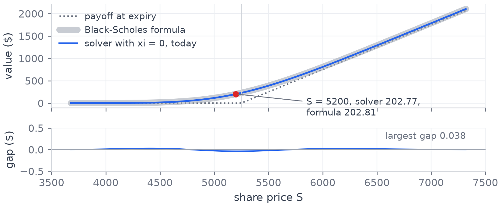{width="1240px" fig-align="center"}

::: {.detail}
Every benchmark job first runs four tests. `test_bs_collapse` is this check,
`test_parity` checks $C - P = S e^{-qT} - K e^{-rT}$ on the full model,
`test_ladder_matches` holds every rung to the baseline, and `test_avx_row`
holds the AVX2 row to the scalar row.
:::

::: {.band}
With its full stencil unchanged, the solver is within 4 cents of the closed
form at today's price. Every benchmark job runs this check first.
:::

::: {.notes}
To validate the solver, we set the volatility of volatility to zero, where
Heston reduces to Black-Scholes, and the unchanged solver lands within 4
cents of the closed-form price.
:::

## The data structure

[Two flat arrays of doubles, read one, write the other, then swap]{.sub}

```{=html}
<!-- svg:layout -->
<svg class="anim" viewBox="0 0 1300 340" xmlns="http://www.w3.org/2000/svg" >
<defs><marker id="stride-arrow" viewBox="0 0 10 10" refX="9" refY="5" markerWidth="7" markerHeight="7" orient="auto"><path d="M0,0 L10,5 L0,10 z" fill="#2563EB"/></marker></defs>
<text x="116.0" y="40.0" font-size="20" text-anchor="end" font-weight="400" class="dim" >j = 2</text>
<rect x="130.0" y="10.0" width="64.0" height="46.0" fill="none" stroke="#D1D5DB" stroke-width="2" stroke-dasharray="6 5"/>
<rect x="194.0" y="10.0" width="64.0" height="46.0" fill="none" stroke="#D1D5DB" stroke-width="2" stroke-dasharray="6 5"/>
<rect x="258.0" y="10.0" width="64.0" height="46.0" fill="none" stroke="#D1D5DB" stroke-width="2" stroke-dasharray="6 5"/>
<rect x="322.0" y="10.0" width="64.0" height="46.0" fill="none" stroke="#D1D5DB" stroke-width="2" stroke-dasharray="6 5"/>
<rect x="386.0" y="10.0" width="64.0" height="46.0" fill="none" stroke="#D1D5DB" stroke-width="2" stroke-dasharray="6 5"/>
<rect x="450.0" y="10.0" width="64.0" height="46.0" fill="none" stroke="#D1D5DB" stroke-width="2" stroke-dasharray="6 5"/>
<text x="116.0" y="90.0" font-size="20" text-anchor="end" font-weight="400" class="dim" >j = 1</text>
<rect x="130.0" y="60.0" width="64.0" height="46.0" fill="none" stroke="#D1D5DB" stroke-width="2" stroke-dasharray="6 5"/>
<rect x="194.0" y="60.0" width="64.0" height="46.0" fill="none" stroke="#D1D5DB" stroke-width="2" stroke-dasharray="6 5"/>
<rect x="258.0" y="60.0" width="64.0" height="46.0" fill="none" stroke="#D1D5DB" stroke-width="2" stroke-dasharray="6 5"/>
<rect x="322.0" y="60.0" width="64.0" height="46.0" fill="none" stroke="#D1D5DB" stroke-width="2" stroke-dasharray="6 5"/>
<rect x="386.0" y="60.0" width="64.0" height="46.0" fill="none" stroke="#D1D5DB" stroke-width="2" stroke-dasharray="6 5"/>
<rect x="450.0" y="60.0" width="64.0" height="46.0" fill="none" stroke="#D1D5DB" stroke-width="2" stroke-dasharray="6 5"/>
<text x="116.0" y="140.0" font-size="20" text-anchor="end" font-weight="400" class="dim" >j = 0</text>
<rect x="130.0" y="110.0" width="64.0" height="46.0" fill="none" stroke="#D1D5DB" stroke-width="2" stroke-dasharray="6 5"/>
<rect x="194.0" y="110.0" width="64.0" height="46.0" fill="none" stroke="#D1D5DB" stroke-width="2" stroke-dasharray="6 5"/>
<rect x="258.0" y="110.0" width="64.0" height="46.0" fill="none" stroke="#D1D5DB" stroke-width="2" stroke-dasharray="6 5"/>
<rect x="322.0" y="110.0" width="64.0" height="46.0" fill="none" stroke="#D1D5DB" stroke-width="2" stroke-dasharray="6 5"/>
<rect x="386.0" y="110.0" width="64.0" height="46.0" fill="none" stroke="#D1D5DB" stroke-width="2" stroke-dasharray="6 5"/>
<rect x="450.0" y="110.0" width="64.0" height="46.0" fill="none" stroke="#D1D5DB" stroke-width="2" stroke-dasharray="6 5"/>
<text x="554.0" y="40.0" font-size="22" text-anchor="start" font-weight="400" >3 variance rows of 6 stock nodes here,</text>
<text x="554.0" y="70.0" font-size="22" text-anchor="start" font-weight="400" >512 rows of 2048 nodes in the real grid.</text>
<g class="fragment go" data-fragment-index="0" style="--tx:0px; --ty:110px"><rect x="130.0" y="110.0" width="64.0" height="46.0" fill="#DBEAFE" stroke="#FFFFFF" stroke-width="3" /><text x="162.0" y="140.0" font-size="19" text-anchor="middle" font-weight="400" >0,0</text><rect x="194.0" y="110.0" width="64.0" height="46.0" fill="#DBEAFE" stroke="#FFFFFF" stroke-width="3" /><text x="226.0" y="140.0" font-size="19" text-anchor="middle" font-weight="400" >1,0</text><rect x="258.0" y="110.0" width="64.0" height="46.0" fill="#DBEAFE" stroke="#FFFFFF" stroke-width="3" /><text x="290.0" y="140.0" font-size="19" text-anchor="middle" font-weight="400" >2,0</text><rect x="322.0" y="110.0" width="64.0" height="46.0" fill="#DBEAFE" stroke="#FFFFFF" stroke-width="3" /><text x="354.0" y="140.0" font-size="19" text-anchor="middle" font-weight="400" >3,0</text><rect x="386.0" y="110.0" width="64.0" height="46.0" fill="#DBEAFE" stroke="#FFFFFF" stroke-width="3" /><text x="418.0" y="140.0" font-size="19" text-anchor="middle" font-weight="400" >4,0</text><rect x="450.0" y="110.0" width="64.0" height="46.0" fill="#DBEAFE" stroke="#FFFFFF" stroke-width="3" /><text x="482.0" y="140.0" font-size="19" text-anchor="middle" font-weight="400" >5,0</text></g>
<g class="fragment go" data-fragment-index="0" style="--tx:384px; --ty:160px"><rect x="130.0" y="60.0" width="64.0" height="46.0" fill="#BFDBFE" stroke="#FFFFFF" stroke-width="3" /><text x="162.0" y="90.0" font-size="19" text-anchor="middle" font-weight="400" >0,1</text><rect x="194.0" y="60.0" width="64.0" height="46.0" fill="#BFDBFE" stroke="#FFFFFF" stroke-width="3" /><text x="226.0" y="90.0" font-size="19" text-anchor="middle" font-weight="400" >1,1</text><rect x="258.0" y="60.0" width="64.0" height="46.0" fill="#BFDBFE" stroke="#FFFFFF" stroke-width="3" /><text x="290.0" y="90.0" font-size="19" text-anchor="middle" font-weight="400" >2,1</text><rect x="322.0" y="60.0" width="64.0" height="46.0" fill="#BFDBFE" stroke="#FFFFFF" stroke-width="3" /><text x="354.0" y="90.0" font-size="19" text-anchor="middle" font-weight="400" >3,1</text><rect x="386.0" y="60.0" width="64.0" height="46.0" fill="#BFDBFE" stroke="#FFFFFF" stroke-width="3" /><text x="418.0" y="90.0" font-size="19" text-anchor="middle" font-weight="400" >4,1</text><rect x="450.0" y="60.0" width="64.0" height="46.0" fill="#BFDBFE" stroke="#FFFFFF" stroke-width="3" /><text x="482.0" y="90.0" font-size="19" text-anchor="middle" font-weight="400" >5,1</text></g>
<g class="fragment go" data-fragment-index="0" style="--tx:768px; --ty:210px"><rect x="130.0" y="10.0" width="64.0" height="46.0" fill="#93C5FD" stroke="#FFFFFF" stroke-width="3" /><text x="162.0" y="40.0" font-size="19" text-anchor="middle" font-weight="400" >0,2</text><rect x="194.0" y="10.0" width="64.0" height="46.0" fill="#93C5FD" stroke="#FFFFFF" stroke-width="3" /><text x="226.0" y="40.0" font-size="19" text-anchor="middle" font-weight="400" >1,2</text><rect x="258.0" y="10.0" width="64.0" height="46.0" fill="#93C5FD" stroke="#FFFFFF" stroke-width="3" /><text x="290.0" y="40.0" font-size="19" text-anchor="middle" font-weight="400" >2,2</text><rect x="322.0" y="10.0" width="64.0" height="46.0" fill="#93C5FD" stroke="#FFFFFF" stroke-width="3" /><text x="354.0" y="40.0" font-size="19" text-anchor="middle" font-weight="400" >3,2</text><rect x="386.0" y="10.0" width="64.0" height="46.0" fill="#93C5FD" stroke="#FFFFFF" stroke-width="3" /><text x="418.0" y="40.0" font-size="19" text-anchor="middle" font-weight="400" >4,2</text><rect x="450.0" y="10.0" width="64.0" height="46.0" fill="#93C5FD" stroke="#FFFFFF" stroke-width="3" /><text x="482.0" y="40.0" font-size="19" text-anchor="middle" font-weight="400" >5,2</text></g>
<g class="fragment" data-fragment-index="0"><text x="1282.0" y="180.0" font-size="20" text-anchor="end" font-weight="400" class="dim" >one std::vector&lt;double&gt;, row 0, then row 1, then row 2</text></g>
<g class="fragment" data-fragment-index="1"><text x="162.0" y="210.0" font-size="18" text-anchor="middle" font-weight="400" class="blue" >0</text><text x="226.0" y="210.0" font-size="18" text-anchor="middle" font-weight="400" class="blue" >1</text><text x="290.0" y="210.0" font-size="18" text-anchor="middle" font-weight="400" class="blue" >2</text><text x="354.0" y="210.0" font-size="18" text-anchor="middle" font-weight="400" class="blue" >3</text><text x="418.0" y="210.0" font-size="18" text-anchor="middle" font-weight="400" class="blue" >4</text><text x="482.0" y="210.0" font-size="18" text-anchor="middle" font-weight="400" class="blue" >5</text><text x="546.0" y="210.0" font-size="18" text-anchor="middle" font-weight="400" class="blue" >6</text><text x="610.0" y="210.0" font-size="18" text-anchor="middle" font-weight="400" class="blue" >7</text><text x="674.0" y="210.0" font-size="18" text-anchor="middle" font-weight="400" class="blue" >8</text><text x="738.0" y="210.0" font-size="18" text-anchor="middle" font-weight="400" class="blue" >9</text><text x="802.0" y="210.0" font-size="18" text-anchor="middle" font-weight="400" class="blue" >10</text><text x="866.0" y="210.0" font-size="18" text-anchor="middle" font-weight="400" class="blue" >11</text><text x="930.0" y="210.0" font-size="18" text-anchor="middle" font-weight="400" class="blue" >12</text><text x="994.0" y="210.0" font-size="18" text-anchor="middle" font-weight="400" class="blue" >13</text><text x="1058.0" y="210.0" font-size="18" text-anchor="middle" font-weight="400" class="blue" >14</text><text x="1122.0" y="210.0" font-size="18" text-anchor="middle" font-weight="400" class="blue" >15</text><text x="1186.0" y="210.0" font-size="18" text-anchor="middle" font-weight="400" class="blue" >16</text><text x="1250.0" y="210.0" font-size="18" text-anchor="middle" font-weight="400" class="blue" >17</text><text x="554.0" y="120.0" font-size="26" text-anchor="start" font-weight="700" class="blue" >index(i, j) = j × 6 + i</text><text x="554.0" y="150.0" font-size="20" text-anchor="start" font-weight="400" class="dim" >j × 2048 + i in the real grid</text></g>
<g class="fragment" data-fragment-index="2"><path d="M 290.0 272 Q 482.0 336 674.0 272" fill="none" stroke="#2563EB" stroke-width="4" marker-end="url(#stride-arrow)"/><text x="704.0" y="312.0" font-size="20" text-anchor="start" font-weight="400" class="blue" >north of (2,0) is 6 cells on, 2048 doubles or 16 KiB in the real grid</text></g>
</svg>
<!-- /svg:layout -->
```

:::: {.columns}
::: {.column width="68%"}
```{.cpp filename="include/grid.h, line 38"}
int index(int stock_i, int var_j) const { return var_j * num_stock_nodes_ + stock_i; }
```

```{.cpp filename="include/grid.h, lines 61 to 62"}
std::vector<double> current_;
std::vector<double> next_;
```
:::

::: {.column width="30%"}
::: {.stats}
<div>**16 KiB** one row of 2048 doubles</div>
<div>**8 MiB** one buffer at 2048 x 512</div>
<div>**16 MiB** both buffers</div>
:::
:::
::::

::: {.band}
The share price axis is contiguous, so the inner loop reads memory in order,
and a step in variance is a stride of one row.
:::

::: {.notes}
*Three clicks: the rows flatten, the index of each cell, the stride to north.*

Both buffers are flat arrays of doubles, with cell i, j at j times the row
length plus i. So the share price axis is contiguous in memory, and a step
in variance is a stride of one row.
:::

## How every number was measured

[One exclusive rangpur r730 compute node, through sbatch]{.sub}

:::: {.columns}
::: {.column width="52%"}
::: {.small}
- Dual Xeon E5-2670 v3, 2 x 12 cores, 30 MiB L3 per socket, g++ 8.5, Open MPI 4.1.
- `--exclusive` on a named node, so no other job shares it.
- Median of 5 repetitions, with the threads pinned to cores.
- The tests run first in the same job, and the price is printed so the
  compiler cannot delete the loop.
- Each job builds from clean and stops unless `make test`, `make test-mpi`
  and `make avx-check` all pass (`slurm/bench_common.sh` lines 62 to 68).
:::
:::

::: {.column width="44%"}
::: {.blk .amber}
[A first round was discarded]{.bt}

Short runs leave cells below $2.2 \times 10^{-308}$, and this CPU handles
those slowly. How many there were changed with the grid, so the rungs ran in
different regimes. Every sweep was rerun with those values flushed to zero,
by a library loaded before `main` that sets two bits of the SSE control
register.

| Rung | as is | flushed |
|:--|--:|--:|
| baseline | 53 | 57 |
| serial | 124 | 159 |
| simd | 320 | 454 |
| omp 24 | 4865 | 6484 |
:::
:::
::::

::: {.band}
Rates are million cell updates per second on the 2048 by 512 grid unless a
slide says otherwise.

[Denormal numbers, D. Goldberg, What every computer scientist should know
about floating-point arithmetic, *ACM Computing Surveys* 23(1), 5 to 48,
1991.]{.cite}
:::

::: {.notes}
Every number is the median of 5 runs on one exclusive rangpur node through
sbatch, after the tests pass in the same job. We discarded our
first sweeps because denormal numbers slowed some versions, and reran
everything with them flushed to zero.
:::

## Where the time goes

[gprof on one thread, and the baseline and serial rungs built at -O0 to -O3, 2048 x 512]{.sub}

:::: {.columns}
::: {.column width="56%"}
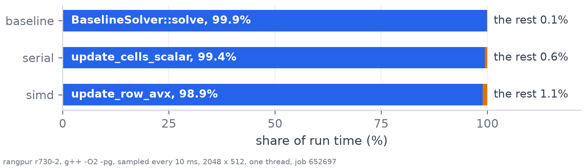{width="100%"}

::: {.small}
- The baseline goes from 11 at -O0 to 58 at -O2.
- -O3 vectorises with two-lane SSE. That doubles the baseline and gives
  serial 1.5x.
- Every benchmark builds at -O2, so each rung measures the change written by
  hand.
:::
:::

::: {.column width="42%"}
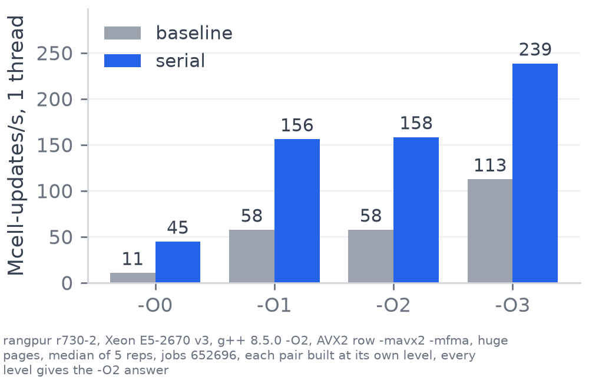{width="100%"}
:::
::::

::: {.band}
One function takes 99 percent of the time in every single-core rung, so every
rung changes that function. At -O3 the compiler takes the baseline to 113,
still below the serial rung's 159 at -O2.
:::

::: {.notes}
Profiling with gprof shows one function, the interior row update, takes 99
percent of the time. Every benchmark builds at O2, where the baseline runs at
58 million updates a second, so each version measures only our change.
:::

## The ladder

[Each rung adds one technique and must give the baseline's answer before it is timed]{.sub}

:::: {.columns}
::: {.column width="58%"}
```{=html}
<!-- svg:ladder -->
<svg class="anim" viewBox="0 0 900 540" xmlns="http://www.w3.org/2000/svg" >
<line x1="120.0" y1="450.0" x2="880.0" y2="450.0" stroke="#D1D5DB" stroke-width="1.5" />
<text x="108.0" y="457.0" font-size="20" text-anchor="end" font-weight="400" class="dim" >10</text>
<line x1="120.0" y1="322.8" x2="880.0" y2="322.8" stroke="#D1D5DB" stroke-width="1.5" />
<text x="108.0" y="329.8" font-size="20" text-anchor="end" font-weight="400" class="dim" >100</text>
<line x1="120.0" y1="195.5" x2="880.0" y2="195.5" stroke="#D1D5DB" stroke-width="1.5" />
<text x="108.0" y="202.5" font-size="20" text-anchor="end" font-weight="400" class="dim" >1,000</text>
<line x1="120.0" y1="68.3" x2="880.0" y2="68.3" stroke="#D1D5DB" stroke-width="1.5" />
<text x="108.0" y="75.3" font-size="20" text-anchor="end" font-weight="400" class="dim" >10,000</text>
<text x="36.0" y="240.0" font-size="20" text-anchor="middle" font-weight="400" class="dim" transform="rotate(-90 36 240.0)">Mcell-updates/s, log scale</text>
<rect x="148.9" y="353.8" width="94.2" height="96.2" fill="#9CA3AF" stroke="none" stroke-width="0" class="bar" style="--d:0.15s"/>
<g class="pop" style="--d:0.45s"><text x="196.0" y="319.8" font-size="22" text-anchor="middle" font-weight="700" >57</text><text x="196.0" y="343.8" font-size="20" text-anchor="middle" font-weight="400" class="dim" >1x</text></g>
<text x="196.0" y="480.0" font-size="21" text-anchor="middle" font-weight="400" >baseline</text>
<rect x="300.9" y="297.1" width="94.2" height="152.9" fill="#2563EB" stroke="none" stroke-width="0" class="bar" style="--d:0.45s"/>
<g class="pop" style="--d:0.75s"><text x="348.0" y="263.1" font-size="22" text-anchor="middle" font-weight="700" >159</text><text x="348.0" y="287.1" font-size="20" text-anchor="middle" font-weight="400" class="dim" >2.8x</text><text x="348.0" y="327.1" font-size="21" text-anchor="middle" font-weight="700" style="fill:#FFFFFF">x2.80</text></g>
<text x="348.0" y="480.0" font-size="21" text-anchor="middle" font-weight="400" >serial</text>
<rect x="452.9" y="238.9" width="94.2" height="211.1" fill="#2563EB" stroke="none" stroke-width="0" class="bar" style="--d:0.75s"/>
<g class="pop" style="--d:1.05s"><text x="500.0" y="204.9" font-size="22" text-anchor="middle" font-weight="700" >456</text><text x="500.0" y="228.9" font-size="20" text-anchor="middle" font-weight="400" class="dim" >8.0x</text><text x="500.0" y="268.9" font-size="21" text-anchor="middle" font-weight="700" style="fill:#FFFFFF">x2.87</text></g>
<text x="500.0" y="480.0" font-size="21" text-anchor="middle" font-weight="400" >simd</text>
<rect x="604.9" y="93.2" width="94.2" height="356.8" fill="#2563EB" stroke="none" stroke-width="0" class="bar" style="--d:1.05s"/>
<g class="pop" style="--d:1.35s"><text x="652.0" y="59.2" font-size="22" text-anchor="middle" font-weight="700" >6,367</text><text x="652.0" y="83.2" font-size="20" text-anchor="middle" font-weight="400" class="dim" >112x</text><text x="652.0" y="123.2" font-size="21" text-anchor="middle" font-weight="700" style="fill:#FFFFFF">x14.0</text></g>
<text x="652.0" y="480.0" font-size="21" text-anchor="middle" font-weight="400" >omp</text>
<text x="652.0" y="506.0" font-size="19" text-anchor="middle" font-weight="400" class="dim" >24 threads</text>
<rect x="756.9" y="88.1" width="94.2" height="361.9" fill="#2563EB" stroke="none" stroke-width="0" class="bar" style="--d:1.35s"/>
<g class="pop" style="--d:1.65s"><text x="804.0" y="54.1" font-size="22" text-anchor="middle" font-weight="700" >6,984</text><text x="804.0" y="78.1" font-size="20" text-anchor="middle" font-weight="400" class="dim" >123x</text><text x="804.0" y="118.1" font-size="21" text-anchor="middle" font-weight="700" style="fill:#FFFFFF">x1.10</text></g>
<text x="804.0" y="480.0" font-size="21" text-anchor="middle" font-weight="400" >mpi</text>
<text x="804.0" y="506.0" font-size="19" text-anchor="middle" font-weight="400" class="dim" >2 x 12</text>
<line x1="120.0" y1="450.0" x2="880.0" y2="450.0" stroke="#1F2937" stroke-width="2" />
</svg>
<!-- /svg:ladder -->
```
:::

::: {.column width="40%"}
| Rung | Technique |
|:--|:--|
| **baseline** | the original loop, with divisions inside it |
| **serial** | divisions turned into multiplications |
| **simd** | four cells per AVX2 instruction |
| **omp** | the rows shared between 24 cores |
| **mpi** | one process per socket, edge rows exchanged |
:::
::::

::: {.band}
The white number inside each bar is the gain over the rung below. The total
on one node is [x]{.em} the baseline.
:::

::: {.notes}
*The bars grow on their own. Point along them from left to right.*

The ladder adds one technique per version, and each version must match the
baseline before it's timed, while the number in each bar is the gain over
the version below.
:::

## The serial rung {auto-animate="true"}

[The baseline divides by the grid spacing in every cell of every step]{.sub}

```{.cpp data-id="row-code" filename="src/solver_baseline.cpp, lines 68 to 72"}
double dV_dS = (east - west) / (2.0 * grid.stock_spacing());
double d2V_dS2 = (east - 2.0 * centre + west) / (grid.stock_spacing() * grid.stock_spacing());
double dV_dv = (north - south) / (2.0 * grid.variance_spacing());
double d2V_dv2 = (north - 2.0 * centre + south) / (grid.variance_spacing() * grid.variance_spacing());
double d2V_dS_dv = (north_east - north_west - south_east + south_west) / (4.0 * grid.stock_spacing() * grid.variance_spacing());
```

::: {.band}
The compiler may not make this change, since the rounding can differ in the
last bit. By hand it gives  million updates a second,
[x]{.em}.
:::

::: {.notes}
*Point at a division, then press next. The code changes into the serial
rung, then one more press grows the bar.*

The baseline divides by the grid spacing in every cell. The compiler can't
turn that into a multiplication by the reciprocal, because the rounding can
differ in the last bit, so we did it by hand, once per solve, for 159 million updates a
second, 2.8 times the baseline.
:::

## The serial rung {auto-animate="true"}

[The five divisions done once per solve, then a multiplication in every cell]{.sub}

```{.cpp data-id="once-code" filename="src/stencil.cpp, lines 28 to 32, once per solve"}
inv_two_ds = 1.0 / (2.0 * stock_spacing);
inv_ds_sq = 1.0 / (stock_spacing * stock_spacing);
inv_two_dv = 1.0 / (2.0 * variance_spacing);
inv_dv_sq = 1.0 / (variance_spacing * variance_spacing);
inv_four_ds_dv = 1.0 / (4.0 * stock_spacing * variance_spacing);
```

```{.cpp data-id="row-code" filename="src/stencil.cpp, lines 107 to 111, every cell of every step"}
double dV_dS = (east - west) * inv_two_ds;
double d2V_dS2 = (east - 2.0 * centre + west) * inv_ds_sq;
double dV_dv = (north - south) * inv_two_dv;
double d2V_dv2 = (north - 2.0 * centre + south) * inv_dv_sq;
double d2V_dS_dv = (north_east - north_west - south_east + south_west) * inv_four_ds_dv;
```

::: {.impact}
```{=html}
<!-- svg:impact-serial -->
<svg class="anim" viewBox="0 0 1000 96" xmlns="http://www.w3.org/2000/svg" >
<text x="220.0" y="32.0" font-size="21" text-anchor="end" font-weight="400" >baseline</text>
<rect x="230.0" y="8.0" width="207.9" height="32.0" fill="#9CA3AF" stroke="none" stroke-width="0" rx="4"/><text x="449.9" y="32.0" font-size="21" text-anchor="start" font-weight="400" class="dim" >57</text>
<text x="220.0" y="76.0" font-size="21" text-anchor="end" font-weight="400" >serial</text>
<g class="fragment"><g class="grow-x"><rect x="230.0" y="52.0" width="580.0" height="32.0" fill="#2563EB" stroke="none" stroke-width="0" rx="4"/></g><text x="822.0" y="76.0" font-size="21" text-anchor="start" font-weight="700" class="blue" >159, 2.8x</text></g>
</svg>
<!-- /svg:impact-serial -->
```
:::

::: {.detail}
The row also copies every constant into a local variable first
(`src/stencil.cpp` lines 66 to 76). It writes through a `double*`, so without
the copies the compiler would reload each constant after every store.
:::

::: {.band}
The compiler may not make this change, since the rounding can differ in the
last bit. By hand it gives  million updates a second,
[x]{.em}.
:::

::: {.notes}
*Same take, continued. Press next for the bar.*
:::

## SIMD, four cells per instruction

[Every cell in a row runs the same formula on neighbours that sit next to each other in memory]{.sub}

:::: {.columns}
::: {.column width="58%"}
```{=html}
<!-- svg:simd -->
<svg class="anim" viewBox="0 0 940 340" xmlns="http://www.w3.org/2000/svg" >
<rect x="20.0" y="200.0" width="60.0" height="60.0" fill="#9CA3AF" stroke="#FFFFFF" stroke-width="3" />
<text x="50.0" y="290.0" font-size="20" text-anchor="middle" font-weight="400" class="dim" >0</text>
<rect x="80.0" y="200.0" width="60.0" height="60.0" fill="#E2E8F0" stroke="#FFFFFF" stroke-width="3" />
<text x="110.0" y="290.0" font-size="20" text-anchor="middle" font-weight="400" class="dim" >1</text>
<rect x="140.0" y="200.0" width="60.0" height="60.0" fill="#E2E8F0" stroke="#FFFFFF" stroke-width="3" />
<text x="170.0" y="290.0" font-size="20" text-anchor="middle" font-weight="400" class="dim" >2</text>
<rect x="200.0" y="200.0" width="60.0" height="60.0" fill="#E2E8F0" stroke="#FFFFFF" stroke-width="3" />
<text x="230.0" y="290.0" font-size="20" text-anchor="middle" font-weight="400" class="dim" >3</text>
<rect x="260.0" y="200.0" width="60.0" height="60.0" fill="#E2E8F0" stroke="#FFFFFF" stroke-width="3" />
<text x="290.0" y="290.0" font-size="20" text-anchor="middle" font-weight="400" class="dim" >4</text>
<rect x="320.0" y="200.0" width="60.0" height="60.0" fill="#E2E8F0" stroke="#FFFFFF" stroke-width="3" />
<text x="350.0" y="290.0" font-size="20" text-anchor="middle" font-weight="400" class="dim" >5</text>
<rect x="380.0" y="200.0" width="60.0" height="60.0" fill="#E2E8F0" stroke="#FFFFFF" stroke-width="3" />
<text x="410.0" y="290.0" font-size="20" text-anchor="middle" font-weight="400" class="dim" >6</text>
<rect x="440.0" y="200.0" width="60.0" height="60.0" fill="#E2E8F0" stroke="#FFFFFF" stroke-width="3" />
<text x="470.0" y="290.0" font-size="20" text-anchor="middle" font-weight="400" class="dim" >7</text>
<rect x="500.0" y="200.0" width="60.0" height="60.0" fill="#E2E8F0" stroke="#FFFFFF" stroke-width="3" />
<text x="530.0" y="290.0" font-size="20" text-anchor="middle" font-weight="400" class="dim" >8</text>
<rect x="560.0" y="200.0" width="60.0" height="60.0" fill="#E2E8F0" stroke="#FFFFFF" stroke-width="3" />
<text x="590.0" y="290.0" font-size="20" text-anchor="middle" font-weight="400" class="dim" >9</text>
<rect x="620.0" y="200.0" width="60.0" height="60.0" fill="#E2E8F0" stroke="#FFFFFF" stroke-width="3" />
<text x="650.0" y="290.0" font-size="20" text-anchor="middle" font-weight="400" class="dim" >10</text>
<rect x="680.0" y="200.0" width="60.0" height="60.0" fill="#E2E8F0" stroke="#FFFFFF" stroke-width="3" />
<text x="710.0" y="290.0" font-size="20" text-anchor="middle" font-weight="400" class="dim" >11</text>
<rect x="740.0" y="200.0" width="60.0" height="60.0" fill="#E2E8F0" stroke="#FFFFFF" stroke-width="3" />
<text x="770.0" y="290.0" font-size="20" text-anchor="middle" font-weight="400" class="dim" >12</text>
<rect x="800.0" y="200.0" width="60.0" height="60.0" fill="#E2E8F0" stroke="#FFFFFF" stroke-width="3" />
<text x="830.0" y="290.0" font-size="20" text-anchor="middle" font-weight="400" class="dim" >13</text>
<rect x="860.0" y="200.0" width="60.0" height="60.0" fill="#9CA3AF" stroke="#FFFFFF" stroke-width="3" />
<text x="890.0" y="290.0" font-size="20" text-anchor="middle" font-weight="400" class="dim" >14</text>
<text x="470.0" y="326.0" font-size="22" text-anchor="middle" font-weight="400" class="dim" >one row, 15 cells here, 2048 in the real grid</text>
<g class="fragment current-visible" data-fragment-index="0"><rect x="24.0" y="88.0" width="232.0" height="22.0" fill="#93C5FD" stroke="none" stroke-width="0" rx="4"/><text x="268.0" y="106.0" font-size="20" text-anchor="start" font-weight="400" class="blue" >west</text><rect x="84.0" y="118.0" width="232.0" height="22.0" fill="#2563EB" stroke="none" stroke-width="0" rx="4"/><text x="328.0" y="136.0" font-size="20" text-anchor="start" font-weight="400" class="blue" >centre</text><rect x="144.0" y="148.0" width="232.0" height="22.0" fill="#93C5FD" stroke="none" stroke-width="0" rx="4"/><text x="388.0" y="166.0" font-size="20" text-anchor="start" font-weight="400" class="blue" >east</text><text x="200.0" y="60.0" font-size="22" text-anchor="middle" font-weight="400" class="blue" >three of the nine 4-wide loads</text></g>
<g class="fragment current-visible" data-fragment-index="0"><rect x="77.0" y="197.0" width="246.0" height="66.0" fill="none" stroke="#2563EB" stroke-width="6" rx="6"/></g>
<g class="fragment" data-fragment-index="0"><rect x="80.0" y="200.0" width="60.0" height="60.0" fill="#93C5FD" stroke="#FFFFFF" stroke-width="3" /><rect x="140.0" y="200.0" width="60.0" height="60.0" fill="#93C5FD" stroke="#FFFFFF" stroke-width="3" /><rect x="200.0" y="200.0" width="60.0" height="60.0" fill="#93C5FD" stroke="#FFFFFF" stroke-width="3" /><rect x="260.0" y="200.0" width="60.0" height="60.0" fill="#93C5FD" stroke="#FFFFFF" stroke-width="3" /></g>
<g class="fragment current-visible" data-fragment-index="1"><rect x="317.0" y="197.0" width="246.0" height="66.0" fill="none" stroke="#2563EB" stroke-width="6" rx="6"/></g>
<g class="fragment" data-fragment-index="1"><rect x="320.0" y="200.0" width="60.0" height="60.0" fill="#93C5FD" stroke="#FFFFFF" stroke-width="3" /><rect x="380.0" y="200.0" width="60.0" height="60.0" fill="#93C5FD" stroke="#FFFFFF" stroke-width="3" /><rect x="440.0" y="200.0" width="60.0" height="60.0" fill="#93C5FD" stroke="#FFFFFF" stroke-width="3" /><rect x="500.0" y="200.0" width="60.0" height="60.0" fill="#93C5FD" stroke="#FFFFFF" stroke-width="3" /></g>
<g class="fragment current-visible" data-fragment-index="2"><rect x="557.0" y="197.0" width="246.0" height="66.0" fill="none" stroke="#2563EB" stroke-width="6" rx="6"/></g>
<g class="fragment" data-fragment-index="2"><rect x="560.0" y="200.0" width="60.0" height="60.0" fill="#93C5FD" stroke="#FFFFFF" stroke-width="3" /><rect x="620.0" y="200.0" width="60.0" height="60.0" fill="#93C5FD" stroke="#FFFFFF" stroke-width="3" /><rect x="680.0" y="200.0" width="60.0" height="60.0" fill="#93C5FD" stroke="#FFFFFF" stroke-width="3" /><rect x="740.0" y="200.0" width="60.0" height="60.0" fill="#93C5FD" stroke="#FFFFFF" stroke-width="3" /></g>
<g class="fragment current-visible" data-fragment-index="1"><text x="470.0" y="130.0" font-size="24" text-anchor="middle" font-weight="400" class="blue" >stock_i = 5, cells 5 to 8 in the next pass</text></g>
<g class="fragment current-visible" data-fragment-index="2"><text x="470.0" y="130.0" font-size="24" text-anchor="middle" font-weight="400" class="blue" >stock_i = 9, the loop stops at stock_i = 13</text></g>
<g class="fragment" data-fragment-index="3"><rect x="800.0" y="200.0" width="60.0" height="60.0" fill="#FCD34D" stroke="#FFFFFF" stroke-width="3" /></g>
<g class="fragment current-visible" data-fragment-index="3"><rect x="797.0" y="197.0" width="66.0" height="66.0" fill="none" stroke="#D97706" stroke-width="6" rx="6"/><text x="470.0" y="110.0" font-size="24" text-anchor="middle" font-weight="400" class="amber" >cell 13 goes to the scalar row</text><text x="470.0" y="142.0" font-size="22" text-anchor="middle" font-weight="400" class="amber" >2046 interior cells give 511 groups and 2 left over</text></g>
</svg>
<!-- /svg:simd -->
```
:::

::: {.column width="40%"}
::: {.small}
- A 256 bit AVX2 register holds four doubles.
- Four neighbouring cells run the same formula, so one instruction updates
  all four.
- Each group of four cells needs nine overlapping 256 bit loads.
- The last zero to three cells of a row are computed one at a time.
:::
:::
::::

::: {.band}
The serial rung already ran at 96 percent of the scalar peak, so the next
gain came from vector instructions.
:::

::: {.notes}
*Four clicks: the loads, then each group of four, then the scalar cell.*

Serial was already at 96 percent of the scalar peak, so next we used vector
instructions. An AVX2 register holds four doubles, and neighbouring cells
use the same formula, so one instruction updates four cells.
:::

## SIMD code, before and after {auto-animate="true"}

[The serial loop, one cell per pass]{.sub}

```{.cpp data-id="row-code" filename="src/stencil.cpp, lines 93 to 123, the serial row, shortened"}
for (int stock_i = first_stock; stock_i < end_stock; ++stock_i) {
    double centre = row_centre[stock_i];
    double east = row_centre[stock_i + 1];
    double west = row_centre[stock_i - 1];
    // ...
    out_row[stock_i] = centre + dt * change;
}
```

::: {.band}
Each load now reads four doubles and the update is one fused multiply-add,
for  million updates a second, [x]{.em}
serial.
:::

::: {.notes}
*Point at the loads, then press next. The serial loop turns into the AVX2
loop. Three more presses highlight the loads, the fused multiply-add and
store, and the counter, and the last press grows the bar.*

The serial loop turns into the AVX2 loop. Each scalar load
becomes a load of four doubles, the update becomes one fused multiply-add, and the counter
goes up by four. This runs at 456, 2.9 times serial.
:::

## SIMD code, before and after {auto-animate="true"}

[The AVX2 loop, four cells per pass]{.sub}

```{.cpp data-id="row-code" filename="src/stencil_avx.cpp, lines 55 to 112, the AVX2 row, shortened" code-line-numbers="|2-4|6-7|9"}
while (stock_i + 3 <= last_interior) {
    __m256d centre = _mm256_loadu_pd(row_centre + stock_i);
    __m256d east = _mm256_loadu_pd(row_centre + stock_i + 1);
    __m256d west = _mm256_loadu_pd(row_centre + stock_i - 1);
    // ...
    __m256d new_value = _mm256_fmadd_pd(dt, change, centre);
    _mm256_storeu_pd(out_row + stock_i, new_value);

    stock_i = stock_i + 4;
}
```

::: {.impact}
```{=html}
<!-- svg:impact-simd -->
<svg class="anim" viewBox="0 0 1000 96" xmlns="http://www.w3.org/2000/svg" >
<text x="220.0" y="32.0" font-size="21" text-anchor="end" font-weight="400" >serial</text>
<rect x="230.0" y="8.0" width="202.2" height="32.0" fill="#9CA3AF" stroke="none" stroke-width="0" rx="4"/><text x="444.2" y="32.0" font-size="21" text-anchor="start" font-weight="400" class="dim" >159</text>
<text x="220.0" y="76.0" font-size="21" text-anchor="end" font-weight="400" >simd</text>
<g class="fragment"><g class="grow-x"><rect x="230.0" y="52.0" width="580.0" height="32.0" fill="#2563EB" stroke="none" stroke-width="0" rx="4"/></g><text x="822.0" y="76.0" font-size="21" text-anchor="start" font-weight="700" class="blue" >456, 2.9x</text></g>
</svg>
<!-- /svg:impact-simd -->
```
:::

::: {.band}
Each load now reads four doubles and the update is one fused multiply-add,
for  million updates a second, [x]{.em}
serial.
:::

::: {.notes}
*Same take, continued.*
:::

## The compiler was splitting the loads {.dense}

[Experiments E2 and E2b, the same source built two ways]{.sub}

:::: {.columns}
::: {.column width="46%"}
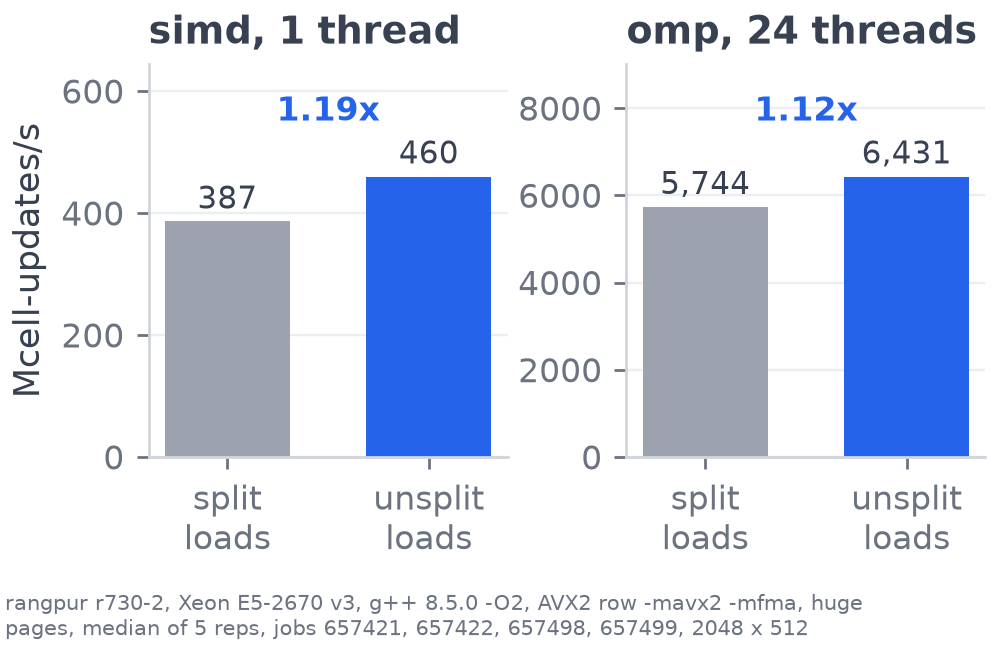{width="100%"}
:::

::: {.column width="51%"}
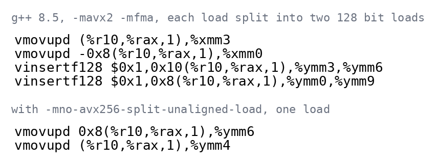{width="100%"}

::: {.small}
With only `-mavx2`, g++ 8.5 tunes for a generic x86 and compiles every
unaligned 256 bit load as two 128 bit loads. With the same flags, the
compiler's own vectorised serial row reaches 77 percent of the hand-written
AVX2 row.
:::

```{.makefile filename="Makefile, line 23"}
NOSPLIT = -mno-avx256-split-unaligned-load -mno-avx256-split-unaligned-store
```
:::
::::

::: {.band}
Two flags make every unaligned load one 256 bit load, with the same answer
and [x]{.em} the speed on one core. Every number
in this video uses them.
:::

::: {.notes}
*Point at the two bars, then at the vinsertf128 lines.*

Our first build ran this at 387, because g++ 8.5 split every unaligned 256
bit load into two 128 bit loads. Two flags make each a single load, for 1.19
times the speed, and every number here uses them.
:::

## SIMD on the roofline

[Measured ceilings of one r730 core]{.sub}

:::: {.columns}
::: {.column width="57%"}
```{=html}
<!-- svg:roof-core -->
<svg class="anim" viewBox="0 0 900 520" xmlns="http://www.w3.org/2000/svg" >
<defs><marker id="rise-arrow" viewBox="0 0 10 10" refX="9" refY="5" markerWidth="7" markerHeight="7" orient="auto"><path d="M0,0 L10,5 L0,10 z" fill="#2563EB"/></marker></defs>
<line x1="110.0" y1="450.0" x2="870.0" y2="450.0" stroke="#D1D5DB" stroke-width="1.5" />
<text x="98.0" y="457.0" font-size="20" text-anchor="end" font-weight="400" class="dim" >1</text>
<line x1="110.0" y1="240.0" x2="870.0" y2="240.0" stroke="#D1D5DB" stroke-width="1.5" />
<text x="98.0" y="247.0" font-size="20" text-anchor="end" font-weight="400" class="dim" >10</text>
<line x1="110.0" y1="30.0" x2="870.0" y2="30.0" stroke="#D1D5DB" stroke-width="1.5" />
<text x="98.0" y="37.0" font-size="20" text-anchor="end" font-weight="400" class="dim" >100</text>
<line x1="110.0" y1="30.0" x2="110.0" y2="450.0" stroke="#D1D5DB" stroke-width="1.5" />
<text x="110.0" y="480.0" font-size="20" text-anchor="middle" font-weight="400" class="dim" >0.1</text>
<line x1="490.0" y1="30.0" x2="490.0" y2="450.0" stroke="#D1D5DB" stroke-width="1.5" />
<text x="490.0" y="480.0" font-size="20" text-anchor="middle" font-weight="400" class="dim" >1</text>
<line x1="870.0" y1="30.0" x2="870.0" y2="450.0" stroke="#D1D5DB" stroke-width="1.5" />
<text x="870.0" y="480.0" font-size="20" text-anchor="middle" font-weight="400" class="dim" >10</text>
<text x="490.0" y="512.0" font-size="20" text-anchor="middle" font-weight="400" class="dim" >arithmetic intensity, flops per byte</text>
<text x="34.0" y="240.0" font-size="20" text-anchor="middle" font-weight="400" class="dim" transform="rotate(-90 34 240.0)">GFLOP/s</text>
<line x1="110.0" y1="430.4" x2="696.7" y2="106.1" stroke="#1F2937" stroke-width="4" pathLength="1" class="draw" style="--d:0.1s"/>
<line x1="696.7" y1="106.1" x2="870.0" y2="106.1" stroke="#1F2937" stroke-width="4" pathLength="1" class="draw" style="--d:0.35s"/>
<g class="pop" style="--d:0.5s"><text x="864.0" y="94.1" font-size="20" text-anchor="end" font-weight="400" >AVX2 FMA peak, 43.4</text></g>
<g class="pop" style="--d:0.3s"><text x="122.0" y="400.4" font-size="20" text-anchor="start" font-weight="400" transform="rotate(-28.9 122.0 400.4)">memory roof, 12.4 GB/s</text></g>
<line x1="344.0" y1="301.1" x2="870.0" y2="301.1" stroke="#6B7280" stroke-width="3" stroke-dasharray="10 7" class="pop" style="--d:0.6s"/>
<g class="pop" style="--d:0.6s"><text x="864.0" y="327.1" font-size="20" text-anchor="end" font-weight="400" class="dim" >scalar peak, 5.12</text></g>
<line x1="532.2" y1="30" x2="532.2" y2="450" stroke="#9CA3AF" stroke-width="2.5" stroke-dasharray="6 6"/>
<text x="540.2" y="438.0" font-size="19" text-anchor="start" font-weight="400" class="dim" >31 / 24 = 1.29</text>
<g class="fragment" data-fragment-index="0"><circle cx="532.2" cy="305.1" r="11" fill="#FFFFFF" stroke="#6B7280" stroke-width="4"/><text x="512.2" y="312.1" font-size="21" text-anchor="end" font-weight="400" >serial 4.9</text></g>
<g class="fragment" data-fragment-index="1"><g class="fragment go" data-fragment-index="1" style="--tx:0px; --ty:-96.4px"><circle cx="532.2" cy="305.1" r="11" fill="#2563EB" stroke="#2563EB" stroke-width="4"/></g><text x="512.2" y="200.7" font-size="21" text-anchor="end" font-weight="700" class="blue" >simd 14.1</text><text x="512.2" y="263.9" font-size="21" text-anchor="end" font-weight="400" class="blue" >2.9x</text></g>
<g class="fragment" data-fragment-index="2"><circle cx="532.2" cy="222.6" r="7" fill="#FFFFFF" stroke="#2563EB" stroke-width="3"/><text x="552.2" y="234.6" font-size="20" text-anchor="start" font-weight="400" class="blue" >simd, 4096 x 1024, 12.1</text></g>
<line x1="110.0" y1="450.0" x2="870.0" y2="450.0" stroke="#1F2937" stroke-width="2" />
</svg>
<!-- /svg:roof-core -->
```
:::

::: {.column width="40%"}
::: {.small}
- 31 flops per cell, 15 for the five differences and 16 for the terms and
  the step, with an FMA counted as two.
- 24 bytes per cell, 8 read, 8 written and 8 more because a store first
  reads its cache line. So every rung sits at 31 / 24 = 1.29 flops per byte.
- simd is below 4x serial because four cells need nine overlapping loads and
  two table loads, unaligned loads cross a cache line every other pass, and
  one core already streams about 11 of its 12.4 GB/s.
:::
:::
::::

::: {.band}
simd does  GFLOP/s, a third of the AVX2 ceiling and just
under the one-core memory roof. On 4096 x 1024 memory slows it by 14 percent.

[S. Williams, A. Waterman and D. Patterson, Roofline: an insightful visual
performance model for multicore architectures, *Communications of the ACM*
52(4), 65 to 76, 2009.]{.cite}
:::

::: {.notes}
*The roofs draw on their own. Press next for serial, next for simd rising
above it, next for the big grid.*

On the one-core roofline, serial is at the scalar peak. SIMD reaches 14
gigaflops, a third of the AVX2 ceiling and just below the memory roof of
one core.
:::

## OpenMP, one block of rows per thread

[The rows of each step are shared between the cores of one node]{.sub}

:::: {.columns}
::: {.column width="58%"}
```{=html}
<!-- svg:omp -->
<svg class="anim" viewBox="0 0 960 520" xmlns="http://www.w3.org/2000/svg" >
<rect x="170.0" y="20.0" width="380.0" height="460.0" fill="#E5E7EB" stroke="#D1D5DB" stroke-width="1" />
<text x="146.0" y="250.0" font-size="22" text-anchor="middle" font-weight="400" class="dim" transform="rotate(-90 146 250.0)">variance rows 0 to 511</text>
<g class="fragment" data-fragment-index="0"><rect x="170.0" y="459.3" width="380.0" height="19.8" fill="#93C5FD" stroke="none" stroke-width="0" /><rect x="170.0" y="439.6" width="380.0" height="19.8" fill="#2563EB" stroke="none" stroke-width="0" /><rect x="170.0" y="419.8" width="380.0" height="19.8" fill="#93C5FD" stroke="none" stroke-width="0" /><rect x="170.0" y="400.0" width="380.0" height="19.8" fill="#2563EB" stroke="none" stroke-width="0" /><rect x="170.0" y="380.3" width="380.0" height="19.8" fill="#93C5FD" stroke="none" stroke-width="0" /><rect x="170.0" y="360.5" width="380.0" height="19.8" fill="#2563EB" stroke="none" stroke-width="0" /><rect x="170.0" y="341.6" width="380.0" height="18.9" fill="#93C5FD" stroke="none" stroke-width="0" /><rect x="170.0" y="322.8" width="380.0" height="18.9" fill="#2563EB" stroke="none" stroke-width="0" /><rect x="170.0" y="303.9" width="380.0" height="18.9" fill="#93C5FD" stroke="none" stroke-width="0" /><rect x="170.0" y="285.0" width="380.0" height="18.9" fill="#2563EB" stroke="none" stroke-width="0" /><rect x="170.0" y="266.2" width="380.0" height="18.9" fill="#93C5FD" stroke="none" stroke-width="0" /><rect x="170.0" y="247.3" width="380.0" height="18.9" fill="#2563EB" stroke="none" stroke-width="0" /><rect x="170.0" y="228.4" width="380.0" height="18.9" fill="#93C5FD" stroke="none" stroke-width="0" /><rect x="170.0" y="209.6" width="380.0" height="18.9" fill="#2563EB" stroke="none" stroke-width="0" /><rect x="170.0" y="190.7" width="380.0" height="18.9" fill="#93C5FD" stroke="none" stroke-width="0" /><rect x="170.0" y="171.8" width="380.0" height="18.9" fill="#2563EB" stroke="none" stroke-width="0" /><rect x="170.0" y="153.0" width="380.0" height="18.9" fill="#93C5FD" stroke="none" stroke-width="0" /><rect x="170.0" y="134.1" width="380.0" height="18.9" fill="#2563EB" stroke="none" stroke-width="0" /><rect x="170.0" y="115.2" width="380.0" height="18.9" fill="#93C5FD" stroke="none" stroke-width="0" /><rect x="170.0" y="96.4" width="380.0" height="18.9" fill="#2563EB" stroke="none" stroke-width="0" /><rect x="170.0" y="77.5" width="380.0" height="18.9" fill="#93C5FD" stroke="none" stroke-width="0" /><rect x="170.0" y="58.6" width="380.0" height="18.9" fill="#2563EB" stroke="none" stroke-width="0" /><rect x="170.0" y="39.8" width="380.0" height="18.9" fill="#93C5FD" stroke="none" stroke-width="0" /><rect x="170.0" y="20.9" width="380.0" height="18.9" fill="#2563EB" stroke="none" stroke-width="0" /><text x="566.0" y="476.2" font-size="21" text-anchor="start" font-weight="400" >thread 0, rows 1 to 22</text><text x="566.0" y="390.0" font-size="21" text-anchor="start" font-weight="400" class="dim" >⋮  threads 1 to 22</text><text x="566.0" y="37.3" font-size="21" text-anchor="start" font-weight="400" >thread 23, rows 490 to 510</text></g>
<g class="fragment current-visible" data-fragment-index="1"><rect x="560.0" y="150.0" width="390.0" height="76.0" fill="#FFFFFF" stroke="#D97706" stroke-width="3" rx="8"/><text x="755.0" y="182.0" font-size="21" text-anchor="middle" font-weight="400" class="amber" >implicit barrier at the end of the loop</text><text x="755.0" y="210.0" font-size="21" text-anchor="middle" font-weight="400" class="amber" >all 24 threads wait for the last one</text></g>
<g class="fragment" data-fragment-index="2"><rect x="170.0" y="479.1" width="380.0" height="8.0" fill="#D97706" stroke="none" stroke-width="0" /><rect x="170.0" y="20.0" width="380.0" height="8.0" fill="#D97706" stroke="none" stroke-width="0" /><rect x="170.0" y="20.0" width="7.0" height="460.0" fill="#D97706" stroke="none" stroke-width="0" /><rect x="543.0" y="20.0" width="7.0" height="460.0" fill="#D97706" stroke="none" stroke-width="0" /></g>
<g class="fragment current-visible" data-fragment-index="2"><rect x="560.0" y="150.0" width="390.0" height="76.0" fill="#FFFFFF" stroke="#D97706" stroke-width="3" rx="8"/><text x="755.0" y="182.0" font-size="21" text-anchor="middle" font-weight="400" class="amber" >then the main thread alone updates</text><text x="755.0" y="210.0" font-size="21" text-anchor="middle" font-weight="400" class="amber" >row 0, the stock edges, then row 511</text></g>
<g class="fragment" data-fragment-index="3"><rect x="560.0" y="150.0" width="390.0" height="76.0" fill="#FFFFFF" stroke="#2563EB" stroke-width="3" rx="8"/><text x="755.0" y="182.0" font-size="21" text-anchor="middle" font-weight="400" class="blue" >swap the buffers</text><text x="755.0" y="210.0" font-size="21" text-anchor="middle" font-weight="400" class="blue" >and the same split every step</text></g>
</svg>
<!-- /svg:omp -->
```
:::

::: {.column width="40%"}
::: {.small}
- `schedule(static)` gives each thread one contiguous block of rows, the
  same block every step.
- Every thread reads the old buffer and writes only its own rows, so no locks
  are needed.
- The loop ends with an implicit barrier. Then the main thread updates the
  boundaries and swaps the buffers.
- Every row costs the same, so `schedule(dynamic)` only added overhead, up to
  43 percent slower (E5).
:::
:::
::::

::: {.band}
The code change is one pragma above the row loop.
:::

::: {.notes}
*Four clicks: the bands, the barrier, the boundaries, the swap.*

With OpenMP each thread gets a contiguous block of rows. The threads read
the old buffer and write only their own rows, so there are no data races
and no locks. Then the main thread updates the boundaries.
:::

## OpenMP code {auto-animate="true"}

[The SIMD rung's row loop]{.sub}

```{.cpp data-id="loop-code" filename="src/solver_simd.cpp, lines 47 to 50"}
// Update every interior row, four cells at a time.
for (int var_j = 1; var_j < num_variance_nodes - 1; ++var_j) {
    update_row_avx(constants, current, next, var_j);
}
```

::: {.band}
On 24 cores,  million updates a second,
[x]{.em} the SIMD rung. `default(none)` makes a forgotten
shared variable a compile error.
:::

::: {.notes}
*Press next and the pragma appears above the same loop. One more press
grows the bar.*

The code change is one pragma above the row loop. On 24 cores this gives
6367 million updates a second, 14 times SIMD.
:::

## OpenMP code {auto-animate="true"}

[The same loop with one pragma]{.sub}

```{.cpp data-id="loop-code" filename="src/solver_omp.cpp, lines 43 to 48"}
// Split the interior rows between the threads, one equal band each.
// Threads only read current and only write their own rows of next, so no locks are needed.
#pragma omp parallel for schedule(static) default(none) shared(constants, current, next, num_variance_nodes)
for (int var_j = 1; var_j < num_variance_nodes - 1; ++var_j) {
    update_row_avx(constants, current, next, var_j);
}
```

::: {.impact}
```{=html}
<!-- svg:impact-omp -->
<svg class="anim" viewBox="0 0 1000 96" xmlns="http://www.w3.org/2000/svg" >
<text x="220.0" y="32.0" font-size="21" text-anchor="end" font-weight="400" >simd</text>
<rect x="230.0" y="8.0" width="41.5" height="32.0" fill="#9CA3AF" stroke="none" stroke-width="0" rx="4"/><text x="283.5" y="32.0" font-size="21" text-anchor="start" font-weight="400" class="dim" >456</text>
<text x="220.0" y="76.0" font-size="21" text-anchor="end" font-weight="400" >omp, 24 threads</text>
<g class="fragment"><g class="grow-x"><rect x="230.0" y="52.0" width="580.0" height="32.0" fill="#2563EB" stroke="none" stroke-width="0" rx="4"/></g><text x="822.0" y="76.0" font-size="21" text-anchor="start" font-weight="700" class="blue" >6367, 14x</text></g>
</svg>
<!-- /svg:impact-omp -->
```
:::

::: {.band}
On 24 cores,  million updates a second,
[x]{.em} the SIMD rung. `default(none)` makes a forgotten
shared variable a compile error.
:::

::: {.notes}
*Same take, continued.*
:::

## Strong scaling

[The same 2048 x 512 grid on 1 to 24 threads, with Amdahl's law $1/S = f + (1 - f)/p$ fitted]{.sub}

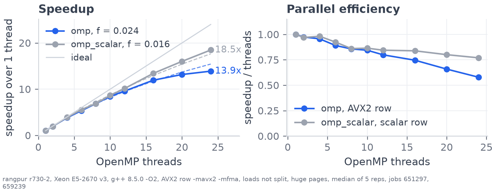{width="1140px" fig-align="center"}

::: {.detail}
The least squares fit gives f = 2.4 percent for the AVX2 row and 1.6 percent
for the scalar row. The boundaries are 0.44 percent of a one-thread step, so
most of f is the fork and barrier every step and the shared caches. At 24
threads the AVX2 row moves about 151 GB/s through the caches, 2.2 times the
DRAM triad.
:::

::: {.band}
x on 24 threads, a serial fraction
$f = $ percent. The scalar row reaches
x, because each of its threads needs data at a
third of the rate.

[Amdahl's law, COSC3500 lecture 3. Fitting $f$ to measured speedups, A. H.
Karp and H. P. Flatt, Measuring parallel processor performance,
*Communications of the ACM* 33(5), 539 to 543, 1990.]{.cite}
:::

::: {.notes}
With the grid fixed, 24 threads give 13.9 times, and Amdahl's law fits a
serial fraction of 2.4 percent. The boundaries are only 0.4 percent of a
one-thread step, so most of that is the fork and barrier every step and the
shared caches, while at 24 threads the boundaries grow to 9 percent.
:::

## Weak scaling

[21 rows per thread, the grid grows with the threads, Gustafson's law $S = f + (1 - f)N$]{.sub}

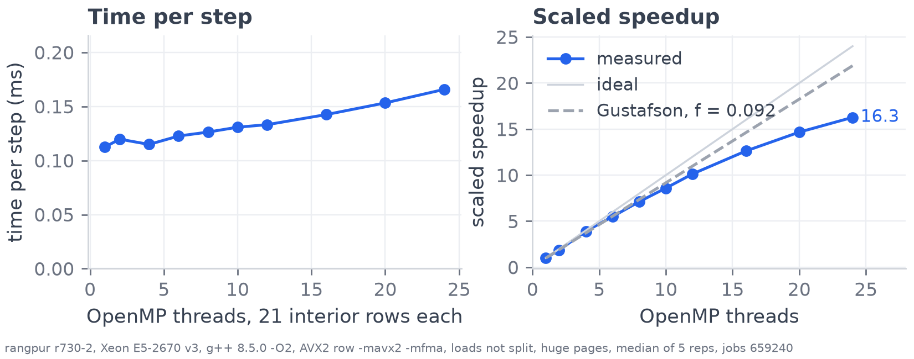{width="1240px" fig-align="center"}

::: {.detail}
v_max grows with the rows, so the spacing stays the same. At 24 threads the
boundaries take 9.2 percent of a step, so Gustafson predicts
24 − 0.092 × 23 = 21.9 against the measured 16.3. The one-thread grid,
370 KiB a buffer, is already larger than a core's 256 KiB L2.
:::

::: {.band}
The step time grows from 0.11 to 0.17 ms, a scaled speedup of
 on 24 threads, where Gustafson with
$f = $ predicts .

[J. L. Gustafson, Reevaluating Amdahl's law, *Communications of the ACM*
31(5), 532 to 533, 1988.]{.cite}
:::

::: {.notes}
For weak scaling each thread keeps 21 rows, so the grid grows with the
threads. The step time goes from 0.11 to 0.17 milliseconds, a scaled
speedup of 16 on 24 threads, below Gustafson's prediction of 22.
:::

## Grid size

[1 MiB to 128 MiB of working set]{.sub}

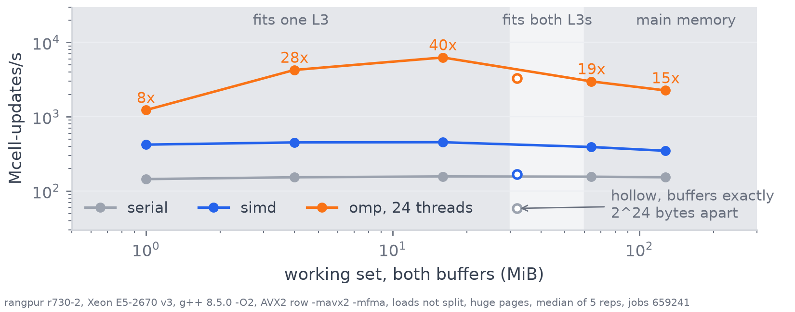{width="1240px" fig-align="center"}

::: {.detail}
Both buffers fit in the two 30 MiB L3 caches up to 2048 by 512, 16 MiB. The
2896 by 724 points are hollow because that grid puts its two buffers exactly
2^24^ bytes apart and every rung is slow there. The grids that trigger it are
known, and the hardware cause has not been found.
:::

::: {.band}
While both buffers fit in the two L3 caches, 24 threads run
x serial. At 4096 by 1024 they come from main
memory and the rate halves.
:::

::: {.notes}
Small grids are dominated by the fixed cost of each step. While both
buffers fit in the two L3 caches, 24 threads run 40 times serial, and at
4096 by 1024, where they don't fit, the rate halves.
:::

## After threads, memory bandwidth

[Measured ceilings of the whole node]{.sub}

:::: {.columns}
::: {.column width="57%"}
```{=html}
<!-- svg:roof-node -->
<svg class="anim" viewBox="0 0 900 520" xmlns="http://www.w3.org/2000/svg" >
<defs><marker id="rise-arrow" viewBox="0 0 10 10" refX="9" refY="5" markerWidth="7" markerHeight="7" orient="auto"><path d="M0,0 L10,5 L0,10 z" fill="#2563EB"/></marker></defs>
<line x1="110.0" y1="450.0" x2="870.0" y2="450.0" stroke="#D1D5DB" stroke-width="1.5" />
<text x="98.0" y="457.0" font-size="20" text-anchor="end" font-weight="400" class="dim" >1</text>
<line x1="110.0" y1="322.8" x2="870.0" y2="322.8" stroke="#D1D5DB" stroke-width="1.5" />
<text x="98.0" y="329.8" font-size="20" text-anchor="end" font-weight="400" class="dim" >10</text>
<line x1="110.0" y1="195.5" x2="870.0" y2="195.5" stroke="#D1D5DB" stroke-width="1.5" />
<text x="98.0" y="202.5" font-size="20" text-anchor="end" font-weight="400" class="dim" >100</text>
<line x1="110.0" y1="68.3" x2="870.0" y2="68.3" stroke="#D1D5DB" stroke-width="1.5" />
<text x="98.0" y="75.3" font-size="20" text-anchor="end" font-weight="400" class="dim" >1,000</text>
<line x1="110.0" y1="30.0" x2="110.0" y2="450.0" stroke="#D1D5DB" stroke-width="1.5" />
<text x="110.0" y="480.0" font-size="20" text-anchor="middle" font-weight="400" class="dim" >0.1</text>
<line x1="490.0" y1="30.0" x2="490.0" y2="450.0" stroke="#D1D5DB" stroke-width="1.5" />
<text x="490.0" y="480.0" font-size="20" text-anchor="middle" font-weight="400" class="dim" >1</text>
<line x1="870.0" y1="30.0" x2="870.0" y2="450.0" stroke="#D1D5DB" stroke-width="1.5" />
<text x="870.0" y="480.0" font-size="20" text-anchor="middle" font-weight="400" class="dim" >10</text>
<text x="490.0" y="512.0" font-size="20" text-anchor="middle" font-weight="400" class="dim" >arithmetic intensity, flops per byte</text>
<text x="34.0" y="240.0" font-size="20" text-anchor="middle" font-weight="400" class="dim" transform="rotate(-90 34 240.0)">GFLOP/s</text>
<line x1="110.0" y1="344.2" x2="870.0" y2="89.7" stroke="#1F2937" stroke-width="4" pathLength="1" class="draw" style="--d:0.1s"/>
<line x1="291.3" y1="69.9" x2="870.0" y2="69.9" stroke="#1F2937" stroke-width="4" pathLength="1" class="draw" style="--d:0.35s"/>
<g class="pop" style="--d:0.5s"><text x="864.0" y="57.9" font-size="20" text-anchor="end" font-weight="400" >AVX2 FMA peak, 971</text></g>
<g class="pop" style="--d:0.3s"><text x="122.0" y="314.2" font-size="20" text-anchor="start" font-weight="400" transform="rotate(-18.5 122.0 314.2)">memory roof, 67.9 GB/s</text></g>
<line x1="532.2" y1="30" x2="532.2" y2="450" stroke="#9CA3AF" stroke-width="2.5" stroke-dasharray="6 6"/>
<text x="540.2" y="438.0" font-size="19" text-anchor="start" font-weight="400" class="dim" >31 / 24 = 1.29</text>
<g class="fragment" data-fragment-index="0"><circle cx="532.2" cy="303.8" r="11" fill="#FFFFFF" stroke="#6B7280" stroke-width="4"/><text x="512.2" y="310.8" font-size="21" text-anchor="end" font-weight="400" >simd, one core, 14.1</text></g>
<g class="fragment" data-fragment-index="1"><g class="fragment go" data-fragment-index="1" style="--tx:0px; --ty:-145.1px"><circle cx="532.2" cy="303.8" r="11" fill="#2563EB" stroke="#2563EB" stroke-width="4"/></g><text x="512.2" y="165.6" font-size="21" text-anchor="end" font-weight="700" class="blue" >omp, 2048 x 512, 195</text></g>
<g class="fragment" data-fragment-index="2"><circle cx="532.2" cy="199.5" r="11" fill="#FFFFFF" stroke="#2563EB" stroke-width="4"/><text x="554.2" y="229.5" font-size="20" text-anchor="start" font-weight="400" class="blue" >omp, 4096 x 1024, 93, on the roof</text></g>
<line x1="110.0" y1="450.0" x2="870.0" y2="450.0" stroke="#1F2937" stroke-width="2" />
</svg>
<!-- /svg:roof-node -->
```
:::

::: {.column width="40%"}
::: {.small}
- On 2048 x 512 the grid fits in the L3 caches, so the rung runs above the
  memory roof.
- On 4096 x 1024 it sits on the memory roof.
- The node's AVX2 ceiling of 971 GFLOP/s is five times the small grid's rate.
:::
:::
::::

::: {.band}
After threads the limit on the big grid is memory bandwidth,
 GFLOP/s at a memory roof of about 88.

[S. Williams, A. Waterman and D. Patterson, Roofline: an insightful visual
performance model for multicore architectures, *Communications of the ACM*
52(4), 65 to 76, 2009.]{.cite}
:::

::: {.notes}
*Press next for one core of simd, next for 24 threads rising, next for the
big grid on the memory roof.*

On the node roofline the small grid runs above the memory roof, because it
fits in L3. The big grid is on the memory roof, so it's
limited by memory bandwidth.
:::

## Placement

[Which socket the threads run on, and which socket's memory holds the pages]{.sub}

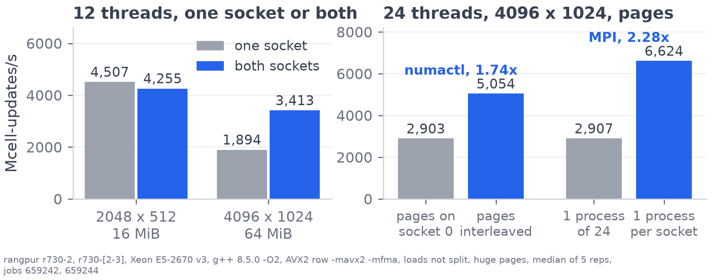{width="1160px" fig-align="center"}

::: {.detail}
The CPUs are numbered even on socket 0 and odd on socket 1, so
`OMP_PROC_BIND=close` splits every even thread count over both sockets.
`numactl --interleave=all` made 24 threads 1.74x faster on the big grid (E7),
and `MALLOC_MMAP_THRESHOLD_` gives every repetition fresh 2 MiB huge pages.
:::

::: {.band}
Two sockets give two L3 caches and two memory controllers. Each page is
placed on the socket whose thread first writes it.

[Pages and sockets, U. Drepper, What every programmer should know about
memory, Red Hat, 2007, section 5 on NUMA.]{.cite}
:::

::: {.notes}
*Point at the 4096 pair on the left, then the two pairs on the right.*

On the big grid, 12 threads gave 1894 on one socket and 3413 on both. The
main thread writes every page first, so all of them sit on socket 0, and
interleaving them made 24 threads 1.74 times faster.
:::

## MPI, one block of rows per process

[Each process updates its own rows and receives one row from each neighbour]{.sub}

:::: {.columns}
::: {.column width="58%"}
```{=html}
<!-- svg:mpi -->
<svg class="anim" viewBox="0 0 960 500" xmlns="http://www.w3.org/2000/svg" >
<defs><marker id="row-arrow" viewBox="0 0 10 10" refX="9" refY="5" markerWidth="7" markerHeight="7" orient="auto"><path d="M0,0 L10,5 L0,10 z" fill="#2563EB"/></marker></defs>
<text x="240.0" y="30.0" font-size="22" text-anchor="middle" font-weight="700" >process 0, owns rows 0 to 255</text>
<text x="720.0" y="30.0" font-size="22" text-anchor="middle" font-weight="700" >process 1, owns rows 256 to 511</text>
<rect x="110.0" y="70.0" width="260.0" height="40.0" fill="#F3F4F6" stroke="#D1D5DB" stroke-width="2" rx="4" />
<text x="240.0" y="97.0" font-size="19" text-anchor="middle" font-weight="400" class="dim" >row 511</text>
<rect x="110.0" y="116.0" width="260.0" height="40.0" fill="#F3F4F6" stroke="#D1D5DB" stroke-width="2" rx="4" />
<text x="240.0" y="143.0" font-size="19" text-anchor="middle" font-weight="400" class="dim" >⋮</text>
<rect x="110.0" y="162.0" width="260.0" height="40.0" fill="#F3F4F6" stroke="#D1D5DB" stroke-width="2" rx="4" />
<text x="240.0" y="189.0" font-size="19" text-anchor="middle" font-weight="400" class="dim" >row 257</text>
<rect x="110.0" y="208.0" width="260.0" height="40.0" fill="#F3F4F6" stroke="#9CA3AF" stroke-width="2" rx="4" stroke-dasharray="7 5"/>
<text x="240.0" y="235.0" font-size="19" text-anchor="middle" font-weight="400" class="dim" >row 256</text>
<rect x="110.0" y="254.0" width="260.0" height="40.0" fill="#F3F4F6" stroke="#D1D5DB" stroke-width="2" rx="4" />
<text x="240.0" y="281.0" font-size="19" text-anchor="middle" font-weight="400" class="dim" >row 255</text>
<rect x="110.0" y="300.0" width="260.0" height="40.0" fill="#F3F4F6" stroke="#D1D5DB" stroke-width="2" rx="4" />
<text x="240.0" y="327.0" font-size="19" text-anchor="middle" font-weight="400" class="dim" >row 254</text>
<rect x="110.0" y="346.0" width="260.0" height="40.0" fill="#F3F4F6" stroke="#D1D5DB" stroke-width="2" rx="4" />
<text x="240.0" y="373.0" font-size="19" text-anchor="middle" font-weight="400" class="dim" >⋮</text>
<rect x="110.0" y="392.0" width="260.0" height="40.0" fill="#F3F4F6" stroke="#D1D5DB" stroke-width="2" rx="4" />
<text x="240.0" y="419.0" font-size="19" text-anchor="middle" font-weight="400" class="dim" >row 0</text>
<rect x="590.0" y="70.0" width="260.0" height="40.0" fill="#F3F4F6" stroke="#D1D5DB" stroke-width="2" rx="4" />
<text x="720.0" y="97.0" font-size="19" text-anchor="middle" font-weight="400" class="dim" >row 511</text>
<rect x="590.0" y="116.0" width="260.0" height="40.0" fill="#F3F4F6" stroke="#D1D5DB" stroke-width="2" rx="4" />
<text x="720.0" y="143.0" font-size="19" text-anchor="middle" font-weight="400" class="dim" >⋮</text>
<rect x="590.0" y="162.0" width="260.0" height="40.0" fill="#F3F4F6" stroke="#D1D5DB" stroke-width="2" rx="4" />
<text x="720.0" y="189.0" font-size="19" text-anchor="middle" font-weight="400" class="dim" >row 257</text>
<rect x="590.0" y="208.0" width="260.0" height="40.0" fill="#F3F4F6" stroke="#D1D5DB" stroke-width="2" rx="4" />
<text x="720.0" y="235.0" font-size="19" text-anchor="middle" font-weight="400" class="dim" >row 256</text>
<rect x="590.0" y="254.0" width="260.0" height="40.0" fill="#F3F4F6" stroke="#9CA3AF" stroke-width="2" rx="4" stroke-dasharray="7 5"/>
<text x="720.0" y="281.0" font-size="19" text-anchor="middle" font-weight="400" class="dim" >row 255</text>
<rect x="590.0" y="300.0" width="260.0" height="40.0" fill="#F3F4F6" stroke="#D1D5DB" stroke-width="2" rx="4" />
<text x="720.0" y="327.0" font-size="19" text-anchor="middle" font-weight="400" class="dim" >row 254</text>
<rect x="590.0" y="346.0" width="260.0" height="40.0" fill="#F3F4F6" stroke="#D1D5DB" stroke-width="2" rx="4" />
<text x="720.0" y="373.0" font-size="19" text-anchor="middle" font-weight="400" class="dim" >⋮</text>
<rect x="590.0" y="392.0" width="260.0" height="40.0" fill="#F3F4F6" stroke="#D1D5DB" stroke-width="2" rx="4" />
<text x="720.0" y="419.0" font-size="19" text-anchor="middle" font-weight="400" class="dim" >row 0</text>
<g class="fragment" data-fragment-index="0"><rect x="110.0" y="254.0" width="260.0" height="40.0" fill="#BFDBFE" stroke="none" stroke-width="0" rx="4"/><text x="240.0" y="281.0" font-size="19" text-anchor="middle" font-weight="400" >row 255</text><rect x="110.0" y="300.0" width="260.0" height="40.0" fill="#BFDBFE" stroke="none" stroke-width="0" rx="4"/><text x="240.0" y="327.0" font-size="19" text-anchor="middle" font-weight="400" >row 254</text><rect x="110.0" y="346.0" width="260.0" height="40.0" fill="#BFDBFE" stroke="none" stroke-width="0" rx="4"/><text x="240.0" y="373.0" font-size="19" text-anchor="middle" font-weight="400" >⋮</text><rect x="110.0" y="392.0" width="260.0" height="40.0" fill="#BFDBFE" stroke="none" stroke-width="0" rx="4"/><text x="240.0" y="419.0" font-size="19" text-anchor="middle" font-weight="400" >row 0</text><rect x="590.0" y="70.0" width="260.0" height="40.0" fill="#BFDBFE" stroke="none" stroke-width="0" rx="4"/><text x="720.0" y="97.0" font-size="19" text-anchor="middle" font-weight="400" >row 511</text><rect x="590.0" y="116.0" width="260.0" height="40.0" fill="#BFDBFE" stroke="none" stroke-width="0" rx="4"/><text x="720.0" y="143.0" font-size="19" text-anchor="middle" font-weight="400" >⋮</text><rect x="590.0" y="162.0" width="260.0" height="40.0" fill="#BFDBFE" stroke="none" stroke-width="0" rx="4"/><text x="720.0" y="189.0" font-size="19" text-anchor="middle" font-weight="400" >row 257</text><rect x="590.0" y="208.0" width="260.0" height="40.0" fill="#BFDBFE" stroke="none" stroke-width="0" rx="4"/><text x="720.0" y="235.0" font-size="19" text-anchor="middle" font-weight="400" >row 256</text></g>
<g class="fragment" data-fragment-index="1"><rect x="110.0" y="254.0" width="260.0" height="40.0" fill="#2563EB" stroke="none" stroke-width="0" rx="4"/><text x="240.0" y="281.0" font-size="19" text-anchor="middle" font-weight="400" style="fill:#FFFFFF">row 255, edge row</text><rect x="590.0" y="208.0" width="260.0" height="40.0" fill="#2563EB" stroke="none" stroke-width="0" rx="4"/><text x="720.0" y="235.0" font-size="19" text-anchor="middle" font-weight="400" style="fill:#FFFFFF">row 256, edge row</text></g>
<g class="fragment" data-fragment-index="2"><line x1="376.0" y1="274.0" x2="582.0" y2="274.0" stroke="#2563EB" stroke-width="4" marker-end="url(#row-arrow)"/><line x1="584.0" y1="228.0" x2="378.0" y2="228.0" stroke="#2563EB" stroke-width="4" marker-end="url(#row-arrow)"/><rect x="590.0" y="254.0" width="260.0" height="40.0" fill="#93C5FD" stroke="none" stroke-width="0" rx="4"/><text x="720.0" y="281.0" font-size="19" text-anchor="middle" font-weight="400" >row 255, copied row</text><rect x="110.0" y="208.0" width="260.0" height="40.0" fill="#93C5FD" stroke="none" stroke-width="0" rx="4"/><text x="240.0" y="235.0" font-size="19" text-anchor="middle" font-weight="400" >row 256, copied row</text><text x="480.0" y="396.0" font-size="22" text-anchor="middle" font-weight="700" class="blue" >16 KiB</text><text x="480.0" y="422.0" font-size="20" text-anchor="middle" font-weight="400" class="blue" >each way</text></g>
<g class="fragment" data-fragment-index="3"><text x="480.0" y="472.0" font-size="22" text-anchor="middle" font-weight="700" class="blue" >MPI_Waitall, then each process swaps its buffers</text></g>
</svg>
<!-- /svg:mpi -->
```
:::

::: {.column width="40%"}
::: {.small}
- Each process owns a block of rows and keeps its own copy of the grid.
- To update its first and last rows it needs one row from each neighbour,
  held in its copied rows, called ghost rows.
- So every step each process sends its edge rows and receives its
  neighbours'.
- `rows_for_rank` gives the first processes one extra row when the rows do
  not divide evenly, and `MPI_Gatherv` collects the blocks once at the end.
- MPI starts with `MPI_THREAD_FUNNELED`, because only the main thread calls
  it.
:::
:::
::::

::: {.band}
On one node, one process of 12 threads per socket fills its own copy of the
grid, so its pages are in that socket's memory.
:::

::: {.notes}
*Four clicks: the owned rows, the edge rows, the exchange, the wait.*

With MPI each process owns a block of rows. Every step it sends its first
and last rows to its neighbours and receives theirs into its copied rows.
With one process per socket, each fills its own grid, so its pages are
local.
:::

## MPI code, the time loop {.dense auto-animate="true"}

[The OpenMP rung's time loop]{.sub}

```{.cpp data-id="step-code" filename="src/solver_omp.cpp, lines 39 to 59, timer lines left out"}
for (int step = 1; step <= num_timesteps; ++step) {
    // Split the interior rows between the threads, one equal band each.
    // Threads only read current and only write their own rows of next, so no locks are needed.
    #pragma omp parallel for schedule(static) default(none) shared(constants, current, next, num_variance_nodes)
    for (int var_j = 1; var_j < num_variance_nodes - 1; ++var_j) {
        update_row_avx(constants, current, next, var_j);
    }

    // The parallel for ends with every thread waiting for the others.
    // Only the main thread runs the boundaries.
    // The top row goes last because it copies the row below.
    update_zero_row(constants, current, next);
    apply_stock_edges(constants, next, 0, num_variance_nodes, step * dt);
    copy_top_row(constants, next);

    // Swap the buffers for the next step.
    grid.swap_buffers();
}
```

::: {.band}
Each process updates only its own rows and the boundaries it owns, then
exchanges its edge rows before the buffers swap.
:::

::: {.notes}
*Press next and the loop changes into the MPI loop. Then one press per
marked line, and a last press for the bars.*

In the loop, rows for rank gives each process its block, and it updates only
those rows and its own boundaries. The exchange is non-blocking, with MPI
Irecv posted before MPI Isend, and MPI Waitall blocks until both finish, then
at the end MPI Gatherv collects the blocks onto process 0.
:::

## MPI code, the time loop {.dense auto-animate="true"}

[The same loop with the changes for MPI marked]{.sub}

```{.cpp data-id="step-code" filename="src/solver_mpi.cpp, line 145 and lines 156 to 190, timer lines left out" code-line-numbers="|1|4-7|10-16|20|24"}
RowRange owned_rows = rows_for_rank(num_variance_nodes, rank, num_ranks);
for (int step = 1; step <= num_timesteps; ++step) {
    // Split this process's interior rows between its threads.
    #pragma omp parallel for schedule(static) default(none) shared(constants, current, next, first_interior, end_interior)
    for (int var_j = first_interior; var_j < end_interior; ++var_j) {
        update_row_avx(constants, current, next, var_j);
    }

    // Only the owning process updates each boundary.
    if (owns_zero_row) {
        update_zero_row(constants, current, next);
    }
    apply_stock_edges(constants, next, owned_rows.begin, owned_rows.end, step * dt);
    if (owns_top_row) {
        copy_top_row(constants, next);
    }

    // Send the edge rows to the neighbours and receive theirs.
    // The next step reads one row past each end of this process's rows.
    exchange_edge_rows(next, num_stock_nodes, owned_rows, rank, num_ranks);

    grid.swap_buffers();
}
gather_rows(grid, num_stock_nodes, num_variance_nodes, rank, num_ranks);
```

::: {.impact .wide}
```{=html}
<!-- svg:impact-mpi -->
<svg class="anim" viewBox="0 0 1000 96" xmlns="http://www.w3.org/2000/svg" >
<text x="220.0" y="32.0" font-size="21" text-anchor="end" font-weight="400" >omp, 24 threads</text>
<rect x="230.0" y="8.0" width="528.8" height="32.0" fill="#9CA3AF" stroke="none" stroke-width="0" rx="4"/><text x="770.8" y="32.0" font-size="21" text-anchor="start" font-weight="400" class="dim" >6367</text>
<text x="220.0" y="76.0" font-size="21" text-anchor="end" font-weight="400" >mpi, one node</text>
<g class="fragment"><g class="grow-x"><rect x="230.0" y="52.0" width="580.0" height="32.0" fill="#2563EB" stroke="none" stroke-width="0" rx="4"/></g><text x="822.0" y="76.0" font-size="21" text-anchor="start" font-weight="700" class="blue" >6984, 1.10x</text></g>
</svg>
<!-- /svg:impact-mpi -->
```
:::

::: {.band}
Each process updates only its own rows and the boundaries it owns, then
exchanges its edge rows before the buffers swap.
:::

::: {.notes}
*Same take, continued.*
:::

## MPI code, the edge row exchange

[The receive and the send with the neighbour below, then the wait]{.sub}

```{.cpp filename="src/solver_mpi.cpp, lines 55 to 65, in post_edge_rows" code-line-numbers="|5|9"}
// The bottom process has nobody below it.
if (rank > 0) {
    // Post the receive first.
    MPI_Request receive_below;
    MPI_Irecv(row_below, num_stock_nodes, MPI_DOUBLE, rank - 1, message_tag, MPI_COMM_WORLD, &receive_below);
    requests.push_back(receive_below);

    MPI_Request send_below;
    MPI_Isend(first_row, num_stock_nodes, MPI_DOUBLE, rank - 1, message_tag, MPI_COMM_WORLD, &send_below);
    requests.push_back(send_below);
}
```

::: {.fragment}
```{.cpp filename="src/solver_mpi.cpp, lines 86 to 87, in exchange_edge_rows"}
// Wait for every send and receive to finish.
MPI_Waitall((int)requests.size(), requests.data(), MPI_STATUSES_IGNORE);
```
:::

::: {.band}
The receive is posted before the send, and both return immediately.
`MPI_Waitall` blocks until every send and receive has completed.
:::

::: {.notes}
*Same take, continued. Three presses, the receive, the send, the wait.*
:::

## Hybrid layouts

[One and two nodes, two grid sizes]{.sub}

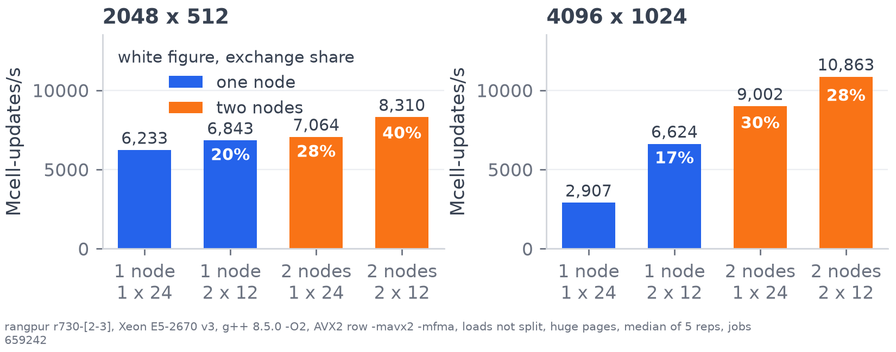{width="1240px" fig-align="center"}

::: {.detail}
The two node runs on the small grid moved between two jobs minutes apart,
8310 in job 659242 and 9364 in job 659243, so the two node gain there lies
between 1.21x and 1.33x. Every other layout agreed within 5 percent.
:::

::: {.band}
Two nodes give [x]{.em} one node on the small
grid and [x]{.em} on the big one. The white
figure is the exchange share of a step.
:::

::: {.notes}
One process per socket made the big grid 2.28 times faster than one
process of 24 threads. Two nodes give
1.21 times one node on the small grid and 1.64 on the big one, and on the
small grid the exchange takes 40 percent of each step.
:::

## Overlapping the exchange with the update

[Experiment E9, the edge rows sent first while the other rows are updated]{.sub}

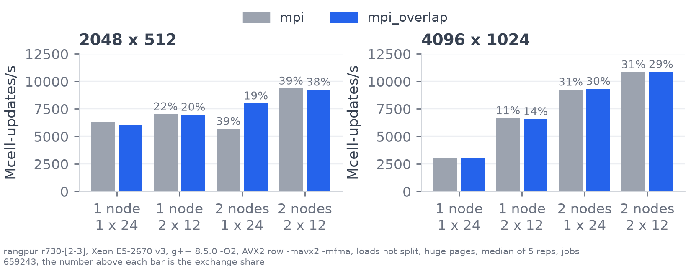{width="1240px" fig-align="center"}

::: {.detail}
Between nodes Open MPI 4.1.1 uses TCP with a 64 KiB eager limit, so a 16 KiB
row leaves at `MPI_Isend`. Within a node shared memory has a 4 KiB eager
limit, so the row waits for a rendezvous inside `MPI_Waitall`, and there is
no progress thread. Raising that limit above 16 KiB would test this.
:::

::: {.band}
It helps only with one process per node, [x]{.em}.
Within a node Open MPI most likely transfers a 16 KiB row only during
`MPI_Waitall`.
:::

::: {.notes}
*Point at the tall blue bar.*

So we tried overlapping the exchange with computation, sending the edge
rows first and updating the rest while they're in transit. That only helped
with one process per node, at 1.41 times. We suspect that within a node
Open MPI waits for the receiver to call MPI Waitall before it transfers a
16 kibibyte row.
:::

## Same answer on every rung

[Price, delta, gamma and vega against the baseline on the test grid]{.sub}

:::: {.columns}
::: {.column width="57%"}
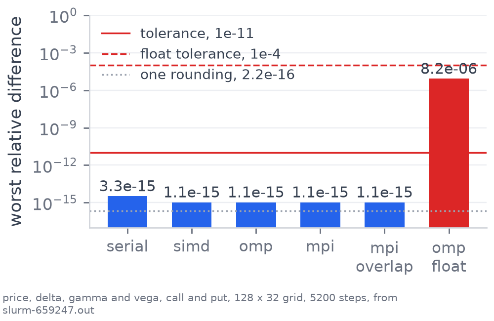{width="100%"}
:::

::: {.column width="40%"}
::: {.small}
- Every rung is within $3.3 \times 10^{-15}$ of the baseline, a few roundings
  of a double.
- OpenMP and MPI equal the SIMD rung bit for bit, because they split the same
  row updates and never sum across workers.
- Float, the red bar, was held to its own limit.
- The tests run on 1, 2 and 7 threads and on 2 and 3 processes, so an uneven
  split of the 32 test rows is checked too.
:::
:::
::::

::: {.band}
No version was timed until it matched, and every benchmark job reran these
tests before timing anything.
:::

::: {.notes}
No version was timed until it matched the baseline. Every version is within
3.3 times 10 to the minus 15, and OpenMP and MPI match SIMD bit for bit.
:::

## Tried and rejected

[Each bar is one variant against the OpenMP rung, 24 threads]{.sub}

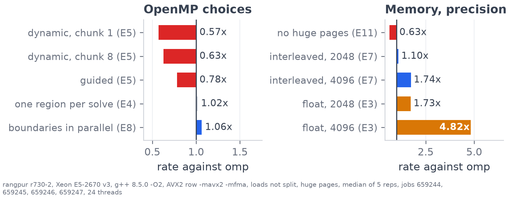{width="1240px" fig-align="center"}

::: {.detail}
Float gave 1.73x on 2048 by 512 and 4.8x on 4096 by 1024, where its 32 MB
fits in the two L3 caches. It priced the option at 196.1256 against 196.1684
in double, and moved gamma by 11.9 percent.
:::

::: {.band}
Dynamic scheduling lost, because every row costs the same. Float was faster
but moved the price by 4 cents, so it was rejected.
:::

::: {.notes}
We tested these variants against OpenMP. Dynamic scheduling was slower,
because every row costs the same. Float was faster, but it moved
the price by 4 cents and gamma by 12 percent, so we rejected it.
:::

## Conclusion

[The ladder against the measured ceilings]{.sub}

:::: {.columns}
::: {.column width="47%"}
::: {.ladder}
| Rung | Mcell/s | Total |
|:--|--:|--:|
| baseline |  | 1x |
| serial |  | x |
| simd |  | x |
| omp, 24 threads |  | x |
| mpi, one node |  | x |
| mpi, two nodes |  | x |
:::
:::

::: {.column width="50%"}
::: {.small}
- Serial reached the scalar peak, so the next gain came from SIMD, and
  unsplit 256 bit loads added x.
- On 24 threads the 4096 x 1024 grid reached the DRAM bandwidth roof of
  68 GB/s, so it is memory bound.
- Across nodes the ghost row exchange is the limit, and overlapping it helps
  only when Open MPI sends the row eagerly at `MPI_Isend`.
:::
:::
::::

::: {.band}
Four of the six hypotheses held. Two nodes were above 80 percent efficient
only on 4096 x 1024, and the serial boundary update grew to
 percent of a step at 24 threads.
:::

::: {.notes}
To conclude, we reached 123 times the baseline on one node and 147 on two.
Most of that is the result of SIMD and threads, and across nodes the
exchange is the main limit. Four of our six hypotheses held.
:::

## What surprised me, and what I would do next

[Looking back over the project]{.sub}

::: {.grid2}
::: {.blk}
[What surprised me]{.bt}

- With only `-mavx2`, g++ 8.5 compiled every unaligned 256 bit load as two
  128 bit loads. Adding `-mno-avx256-split-unaligned-load` and its store
  partner made simd x faster.
- Serial and simd ran up to 2.7x slower on grids whose `current` and `next`
  buffers start exactly $2^{24}$ bytes (16 MiB) apart. The hardware cause is
  still unknown.
- Transparent huge pages, flushing denormal numbers to zero and NUMA
  first-touch page placement each moved the rates as much as some code
  changes did.
:::

::: {.blk}
[What I would do next]{.bt}

- Every rank allocates the whole grid today, so one node's memory caps the
  grid size. Allocating only the rank's own rows plus one ghost row on each
  side lets the grid grow with the number of nodes.
- Set `OMPI_MCA_btl_vader_eager_limit` above the 16 KiB row size, so rows
  inside a node are sent eagerly, to test why E9 helped only between nodes.
- An implicit or ADI scheme has no explicit stability limit on $\Delta t$,
  at the cost of linear solves each step. A CUDA kernel for the row update.
:::
:::

::: {.band}
Compiler flags, the memory allocator and the floating point control register
changed the rates as much as some code changes, so every result file records
the node, compiler and flags.
:::

::: {.notes}
Build and system settings moved the rates as much as some code changes, from
split loads to huge pages. Next, each rank would allocate only its own rows
plus two ghost rows, so the grid can be bigger than one node's memory. We'd
also test the eager limit behind E9, and try an implicit scheme and a GPU
version.
:::

## x on one node, x on two, the same answer on every rung {.closing}

[Every number has a job id in docs/RESULTS.md]{.sub}

[COSC3500 Milestone 2, Zain Al-Saffi]{.sub}

::: {.notes}
Every number here has a job id in the results file, and the repository has
the code to reproduce it. Thanks for watching.
:::

## Appendix {.closing visibility="uncounted"}

[Backup slides for questions. They are not part of the video.]{.sub}

## The problem {visibility="uncounted"}

[The price today of the right to buy a share at a fixed price on a fixed day]{.sub}

:::: {.columns}
::: {.column width="49%"}
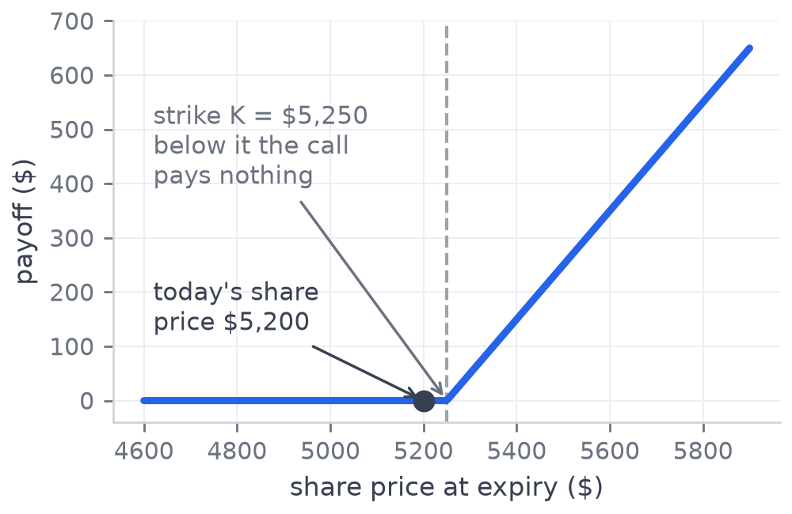{height="480px" fig-align="center"}

::: {.note}
At expiry the value is the payoff, max(S - K, 0).
:::
:::

::: {.column width="49%"}
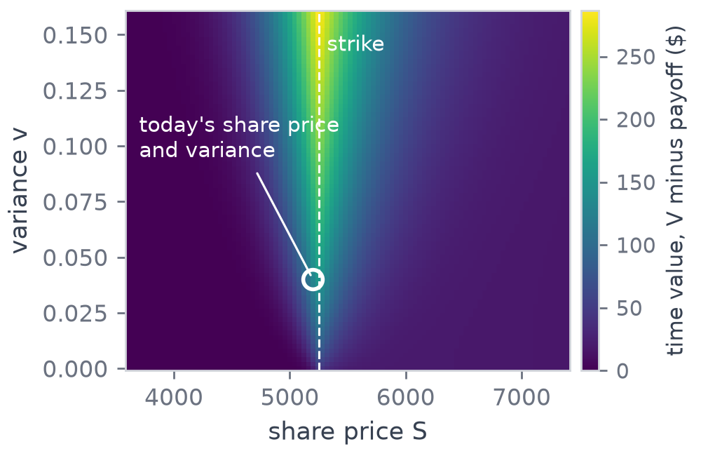{height="480px" fig-align="center"}

::: {.note}
Half way through the solve, the value above the payoff.
:::
:::
::::

::: {.band}
Black-Scholes holds the volatility constant. Heston lets the variance move
randomly too, so the value depends on $S$, $v$ and $t$.
:::

::: {.notes}
*Point at the payoff, then at the circle on the value map.*

At expiry the option is worth its payoff, on the left. Heston lets the
variance move randomly too, and half way through the solve the value above
the payoff rises with variance near the strike.
:::

## The equation {visibility="uncounted"}

[The value $V(S, v, t)$ solves one PDE, and each term has a plain meaning]{.sub}

$$
V_t + \tfrac{1}{2} v S^2 V_{SS} + \rho\xi v S\, V_{Sv} + \tfrac{1}{2}\xi^2 v\, V_{vv}
+ (r - q) S\, V_S + \kappa(\theta - v)\, V_v - r V = 0
$$

| Term | Meaning |
|:--|:--|
| $\tfrac{1}{2} v S^2 V_{SS}$ | Diffusion in the share price, from its random movement. |
| $\rho \xi v S V_{Sv}$ | The correlation between the share and its variance. With $\rho = -0.7$ a falling share raises volatility. |
| $\tfrac{1}{2} \xi^2 v V_{vv}$ | Diffusion in the variance, scaled by the volatility of volatility $\xi$. |
| $(r - q) S V_S$ | The share drifts at the risk-free rate less the dividend yield. |
| $\kappa (\theta - v) V_v$ | Mean reversion of the variance towards its long-run level $\theta$ at rate $\kappa$. |
| $- r V$ | Discounting, because money later is worth less than money now. |

::: {.band}
On the grid each derivative becomes a difference of neighbouring cells, and
one step adds $\Delta t$ times these six terms to the old value.
:::

::: {.notes}
*Run the cursor down the table.*

The option value satisfies this PDE, and the table explains each term. On
the grid each derivative becomes a finite difference of neighbouring cells.
:::

## What the compiler does alone {visibility="uncounted"}

[The baseline and serial rungs built at -O0 to -O3, the same answer at every level]{.sub}

:::: {.columns}
::: {.column width="57%"}
{width="100%"}
:::

::: {.column width="40%"}
::: {.small}
- The baseline goes from 11 at -O0 to 58 at -O2.
- -O3 vectorises with two-lane SSE. That doubles the baseline and gives
  serial 1.5x.
- Every benchmark builds at -O2, so each rung measures the change written by
  hand.
:::
:::
::::

::: {.band}
At -O3 the compiler takes the baseline to 113, still below the serial rung's
159 at -O2.
:::

::: {.notes}
We first tested the compiler alone. O2 takes the baseline from 11 million
updates a second at O0 to 58, and every benchmark builds at O2, so each
version measures only our change.
:::

## Could the compiler have written it? {visibility="uncounted"}

[Experiment E1, the whole program rebuilt under stronger flags, one thread]{.sub}

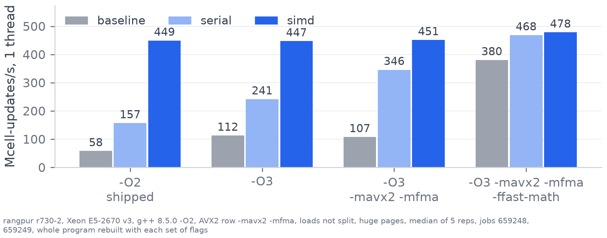{width="1300px" fig-align="center"}

::: {.band}
Given AVX2, g++ reaches 0.77x of the hand-written row. -ffast-math rewrites
the divisions too, but drops the IEEE rules for the whole program.
:::

::: {.notes}
We also tested whether the compiler could write this itself. With AVX2 it
vectorises the serial row to 77 percent of our version. Fast-math also
removes the divisions, but relaxes the IEEE rules for the whole program, so
we didn't use it.
:::

## Where each step goes {visibility="uncounted"}

[Parallel rows, serial boundaries and the edge row exchange, 2048 x 512]{.sub}

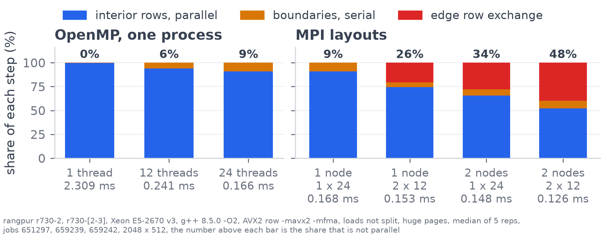{width="1300px" fig-align="center"}

::: {.band}
At 24 threads the serial boundaries take  percent
of a step, as the main thread reads rows other cores just wrote.
:::

::: {.notes}
At 24 threads the serial boundaries grow to 9 percent of each step, because
the main thread reads rows other cores just wrote, and MPI adds the exchange
on top.
:::

## Where everything is {visibility="uncounted"}

[The files to open, in the order the video meets them]{.sub}

::: {.small}
| File | What it holds |
|:--|:--|
| `include/grid.h` | The grid, `index()` and the two buffers. |
| `src/solver_baseline.cpp` | Rung 0, the original loop nest with the divisions inside it. Every rung is checked against it. |
| `src/stencil.cpp` | The constants worked out once, the scalar row and the boundaries. |
| `src/stencil_avx.cpp` | The AVX2 row, the only file built with `-mavx2 -mfma`, with a scalar fallback. |
| `src/solver_{serial,simd,omp,mpi}.cpp` | Rungs 1 to 4, one time loop each. |
| `src/solver.cpp` | `make_solver`, the stability report and reading the price off the grid. |
| `src/solver_experiments.cpp` | Experiments E4, E5 and E8. E2 is in `solver_align.cpp`, E3 in `solver_float.cpp`, E9 in `solver_mpi.cpp`. |
| `tests/` | Four test programs, run by `make test` and `make test-mpi`. |
| `slurm/` | One job script per sweep, all sharing `bench_common.sh`. |
| `scripts/` | Every figure, drawn from the CSVs the jobs wrote. |
| `docs/RESULTS.md` | Every number, with its job id. |
:::

## The Heston model {visibility="uncounted"}

[Where the PDE comes from]{.sub}

:::: {.columns}
::: {.column width="52%"}
::: {.blk}
[Two random processes]{.bt}

$$
\begin{aligned}
dS &= (r - q) S\,dt + \sqrt{v}\, S\, dW_S \\
dv &= \kappa (\theta - v)\,dt + \xi \sqrt{v}\, dW_v \\
dW_S\, dW_v &= \rho\, dt
\end{aligned}
$$
:::

::: {.small}
The Feynman-Kac theorem turns the expected discounted payoff into the PDE.
The random terms become the second derivatives, so the program has no random
number generator.
:::
:::

::: {.column width="44%"}
| Parameter | Value |
|:--|--:|
| today's share price $S_0$ | 5200 |
| strike $K$, expiry $T$ | 5250, 0.25 y |
| rate $r$, dividend yield $q$ | 0.045, 0.013 |
| $v_0 = \theta$ | 0.04 |
| $\kappa$, $\xi$, $\rho$ | 1.5, 0.35, -0.7 |
| grid | 2048 x 512 |
:::
::::

## The five differences {visibility="uncounted"}

[The nine cells a step reads, and what each difference measures]{.sub}

::: {.small}
| | Difference | What it measures |
|:--|:--|:--|
| $V_S$ | (east $-$ west) $/\, 2\Delta S$ | how steeply value rises with share price |
| $V_{SS}$ | (east $- 2V +$ west) $/\, \Delta S^2$ | how curved it is along the share price |
| $V_v$ | (north $-$ south) $/\, 2\Delta v$ | how value changes with variance |
| $V_{vv}$ | (north $- 2V +$ south) $/\, \Delta v^2$ | how curved it is along the variance |
| $V_{Sv}$ | (ne $-$ nw $-$ se $+$ sw) $/\, 4\Delta S \Delta v$ | how the share slope changes with variance, so it needs the four corners |
:::

::: {.small}
The serial rung multiplies by $1/(2\Delta S)$ and the others, worked out once
per solve, where the baseline divides in every cell.
:::

## The boundaries {visibility="uncounted"}

[Each edge of the grid has its own rule, all serial in the OpenMP rung]{.sub}

::: {.small}
| Edge | Rule |
|:--|:--|
| $v = 0$, the bottom row | Every diffusion term has a factor $v$, so only the drift terms are left. $V_v$ looks one row up, because there is no row below. |
| $S = 0$, the first column | A call is worth nothing there. A put is worth the discounted strike. |
| largest $S$, the last column | A call is worth $S e^{-q\tau} - K e^{-r\tau}$ there, and a put nothing. |
| the top variance row | A copy of the row below, so the value stops changing with variance at the top. It runs last. |
:::

::: {.band}
On one thread the boundaries are 0.4 percent of a step. At 24 threads they
are  percent, because the main thread has to
fetch rows that other cores just wrote.
:::

## The timestep limit {visibility="uncounted"}

[An explicit scheme is only stable below a largest timestep]{.sub}

$$
\Delta t_{\text{stable}} = \frac{1}{v_{\max} S_{\max}^2 / \Delta S^2 + \xi^2 v_{\max} / \Delta v^2 + r}
$$

::: {.small}
- The far corner of the grid is the worst cell, where the diffusion is largest.
- At 2048 x 512 the limit is $3.66 \times 10^{-7}$ years, so the real
  three-month solve takes 980000 steps.
- Every benchmark picks its maturity so that $\Delta t$ is 70 percent of the
  limit (`maturity_for` in `bench_common.sh`).
- Above the limit the solution grows without bound and the price comes out as
  `nan`.
:::

## Why an explicit scheme {visibility="uncounted"}

[Each new cell comes straight from known values]{.sub}

::: {.small}
- An explicit step computes each new cell from the old buffer,
  $V^{\text{new}} = V + \Delta t \times$ (the six terms), with no equation to
  solve.
- So the work is a stencil, regular and local, and it splits cleanly between
  lanes, threads and processes.
- An implicit scheme solves a linear system across the whole grid every step.
  That couples the cells and is much harder to parallelise.
- The cost of the explicit choice is the timestep limit, so the solver takes
  many small steps. Each step is the same regular work, and that suits SIMD,
  threads and processes.
:::

## Reading the price and the Greeks {visibility="uncounted"}

[`extract_result` in `src/solver.cpp`, after the last step]{.sub}

::: {.small}
- Today's share price and variance fall between grid nodes, so the price is
  interpolated bilinearly from the four cells around that point.
- The same interpolation one cell to each side gives the values the Greeks
  need.
- Delta and gamma are central differences in the share price, and vega a
  central difference in the variance, per unit of variance.
- The solver says on stderr when the quote is off a node, so an interpolated
  price is never mistaken for a node value.
:::

## Flops and bytes per cell {visibility="uncounted"}

[Where the roofline's x position comes from]{.sub}

::: {.grid2}
::: {.blk}
[31 flops per cell update]{.bt}

15 for the five differences and 16 to add up the PDE terms and step. A fused
multiply-add counts as two.
:::

::: {.blk}
[24 bytes per cell update]{.bt}

8 to read the old value, 8 to write the new one, and 8 more because a store
first reads the cache line it writes into.
:::
:::

::: {.small}
The arithmetic intensity is $31/24 = 1.29$ flops per byte. The rate in
GFLOP/s is the measured cell updates per second times 31. The ceilings come
from `slurm/bench_peak.sh` on the same node, a scalar and an AVX2 FMA loop for
compute and a triad for memory.
:::

## The AVX2 row next to the scalar row {.dense visibility="uncounted"}

[The same sum, one cell or four]{.sub}

```{.cpp filename="src/stencil.cpp, lines 121 to 122, one cell"}
double change = stock_diffusion_term + cross_term + variance_diffusion_term + stock_drift_term + variance_drift_term - rate * centre;
out_row[stock_i] = centre + dt * change;
```

```{.cpp filename="src/stencil_avx.cpp, lines 99 to 109, four cells"}
// fmadd(a, b, c) works out a times b plus c with one rounding.
__m256d change = _mm256_mul_pd(stock_diffusion_factor, d2V_dS2);
change = _mm256_fmadd_pd(cross_factor, d2V_dS_dv, change);
change = _mm256_fmadd_pd(variance_diffusion, d2V_dv2, change);
change = _mm256_fmadd_pd(stock_drift_factor, dV_dS, change);
change = _mm256_fmadd_pd(variance_drift, dV_dv, change);
change = _mm256_fnmadd_pd(rate, centre, change);

// Step back one dt and store the four new values.
__m256d new_value = _mm256_fmadd_pd(dt, change, centre);
_mm256_storeu_pd(out_row + stock_i, new_value);
```

## Why SIMD is below 4x {visibility="uncounted"}

[Four lanes, x measured]{.sub}

::: {.small}
- Each group of four cells needs nine overlapping 4-wide loads, plus two for
  the $S$ and $S^2$ tables.
- The west, centre and east loads are 8 bytes apart, so at most one of them
  can start on a 32 byte boundary. Every unaligned load crosses a cache line
  on every other iteration, and that moves the rate by up to 16 percent
  (E2b).
- At  million updates a second one core moves about
  11 GB/s, close to the 12.4 GB/s it can stream from memory.
- The last zero to three cells of every row are computed one at a time, and
  each row first loads its constants into registers.
:::

::: {.band}
No hardware counters were available in the jobs, so the loss cannot be split
exactly between these causes.
:::

## Where the rows sit in their cache lines {visibility="uncounted"}

[Experiment E2b, one thread, 2048 x 512, with unsplit loads]{.sub}

| Where column 1 sits | Mcell/s |
|:--|--:|
| centre load on a 32 byte boundary | 477 |
| west or east load on a 32 byte boundary | 439 |
| no load on a 32 byte boundary | 412 |
| aligned load instructions, centre aligned | 477 |
| east and west built by register shuffles | 460 |

::: {.small}
An aligned load instruction runs at the same speed as an unaligned one at the
same address. The rate depends on whether a load crosses a cache line.
:::

## Experiment E1 in full {visibility="uncounted"}

[The whole program rebuilt under each set of flags, one thread, 2048 x 512, Mcell/s]{.sub}

::: {.tiny}
| Build | baseline | serial | simd |
|:--|--:|--:|--:|
| `-O2`, shipped | 57.6 | 157.0 | 449.6 |
| `-O3` | 112.5 | 241.3 | 446.9 |
| `-O3 -mavx2 -mfma` | 107.4 | 345.6 | 451.1 |
| `-O3 -mavx2 -mfma`, unsplit loads in the whole program | 106.4 | 362.7 | 452.0 |
| `-O3 -march=native` | 105.9 | 266.3 | 455.8 |
| `-O2 -ffast-math` | 58.6 | 175.1 | 476.5 |
| `-O3 -ffast-math` | 189.5 | 271.5 | 472.7 |
| `-O3 -mavx2 -mfma -ffast-math` | 380.1 | 468.2 | 478.0 |
| `-O3 -mavx2 -mfma -ffast-math`, unsplit loads in the whole program | 376.8 | 399.3 | 478.2 |
:::

::: {.tiny}
The simd column always has unsplit loads, from the two flags on its own file.
Every build gives the `-O2` answers to within $1.1 \times 10^{-14}$. Why
`-march=native` slows serial, and why the fast-math serial rung is slower
with unsplit loads, has not been found. Jobs 659248 and 659249.
:::

## Why there are no locks {visibility="uncounted"}

[`schedule(static)`, `default(none)` and the barrier]{.sub}

::: {.small}
- Each thread reads only `current` and writes only its own rows of `next`. No
  cell is written by two threads, and no thread reads `next` during the loop.
- `schedule(static)` splits the rows into equal contiguous blocks once. Every
  row costs the same, so dynamic scheduling only added overhead (E5, up to
   percent slower).
- `default(none)` makes every variable used in the loop be listed. The loop
  counter and the variables inside the body are private to each thread.
- The parallel loop ends with an implied barrier, so every row is done before
  the boundaries and the swap.
:::

## The swap {visibility="uncounted"}

[Two references bound once, still right after every swap]{.sub}

```{.cpp filename="src/grid.cpp, lines 29 to 33"}
// Swaps which buffer is read and which is written.
// Only the internal pointers are swapped. No numbers are copied.
void Grid::swap_buffers() {
    std::swap(current_, next_);
}
```

```{.cpp filename="src/solver_serial.cpp, lines 32 to 35"}
// Read from current and write to next.
// swap_buffers swaps the contents of these two vectors.
const std::vector<double>& current = grid.current();
std::vector<double>& next = grid.next();
```

::: {.small}
`std::swap` on two vectors swaps their internal pointers and copies no
numbers. The references name the two member vectors, so after the swap
`current` holds what was just written.
:::

## Constants copied into local variables {visibility="uncounted"}

[Why the row starts with a block of copies]{.sub}

```{.cpp filename="src/stencil.cpp, lines 66 to 76"}
// Copy the constants into local variables first.
// Otherwise the compiler may reload them from memory after every write.
double dt = constants.dt;
double rate = constants.rate;
double stock_drift = constants.stock_drift;
double inv_two_ds = constants.inv_two_ds;
double inv_ds_sq = constants.inv_ds_sq;
double inv_two_dv = constants.inv_two_dv;
double inv_dv_sq = constants.inv_dv_sq;
double inv_four_ds_dv = constants.inv_four_ds_dv;
int num_stock_nodes = constants.num_stock_nodes;
```

::: {.small}
The row writes through a `double*`, and the compiler cannot prove that pointer
never points into the constants. Without the copies it would reload every
constant after every store. As locals they stay in registers for the whole
row.
:::

## Amdahl and Gustafson {visibility="uncounted"}

[The two laws with the measured numbers]{.sub}

::: {.grid2}
::: {.blk}
[Amdahl, a fixed problem]{.bt}

$S(p) = 1 / \big(f + (1 - f)/p\big)$. Fitted by least squares to the strong
scaling speedups, $f = $ percent, more than five
times the 0.44 percent of boundary work on one thread. The rest is the fork
and barrier every step and the shared cache bandwidth. The scalar row fits
1.6 percent, because a faster row makes those fixed costs a larger share of
each step.
:::

::: {.blk}
[Gustafson, a growing problem]{.bt}

$S(N) = f + (1 - f) N$, with $f$ the serial share of the parallel run.
Measured on 24 threads $f = $, and that predicts
. The measured scaled speedup is
.
:::
:::

::: {.band}
[Karp and Flatt 1990, Gustafson 1988, as on the scaling slides.]{.cite}
:::

## Thread binding on the r730 nodes {visibility="uncounted"}

[Why `close` alternates sockets]{.sub}

::: {.small}
- The CPUs are numbered even on socket 0 and odd on socket 1 (job 651500
  printed each thread's CPU).
- `OMP_PLACES=cores OMP_PROC_BIND=close` fills CPUs 0, 1, 2, so every even
  thread count is split evenly over the two sockets.
- `spread` with fewer than 24 threads stays on socket 0, so E6 used it to
  measure one socket against two.
- Unbound threads were 1.11x faster on the small grid at 24 threads, and the
  cause has not been found. On the big grid the reps range from 2699 to 4009
  within one job, so the comparison there is noise.
:::

## Page placement, numactl and huge pages {visibility="uncounted"}

[Where the memory of the grid comes from]{.sub}

::: {.small}
- Linux places a page in the memory of the socket whose thread first writes
  it, called the first-touch policy. The grid is filled by the main thread,
  so every page is on socket 0.
- `numactl --interleave=all` spreads the pages over both sockets,
  x on the big grid (E7). Without it the runs
  fall into two groups, near 2800 and near 4000, so the size of the gain
  depends on which group they fall in.
- One MPI process per socket allocates and fills its own copy, so its pages
  are local, x on the big grid.
- `MALLOC_MMAP_THRESHOLD_=1048576` makes every buffer over 1 MiB come from
  `mmap`, so each repetition gets fresh 2 MiB huge pages. Without it only the
  first repetition gets them (E11, 0.63x on 24 threads).
:::

::: {.band}
[U. Drepper, What every programmer should know about memory, Red Hat, 2007,
section 5.]{.cite}
:::

## Which rows a process owns {visibility="uncounted"}

[`rows_for_rank`, and `MPI_Gatherv` at the end]{.sub}

```{.cpp filename="src/solver_mpi.cpp, lines 24 to 41"}
// Works out which rows a process owns when the rows are shared out evenly.
// The first few processes get one extra row each when they do not divide evenly.
static RowRange rows_for_rank(int num_rows, int rank, int num_ranks) {
    int rows_per_rank = num_rows / num_ranks;
    int extra_rows = num_rows % num_ranks;

    RowRange rows;
    if (rank < extra_rows) {
        // One of the first few processes, with one extra row.
        rows.begin = rank * (rows_per_rank + 1);
        rows.end = rows.begin + rows_per_rank + 1;
    } else {
        // Skip past the processes that took an extra row.
        rows.begin = extra_rows * (rows_per_rank + 1) + (rank - extra_rows) * rows_per_rank;
        rows.end = rows.begin + rows_per_rank;
    }
    return rows;
}
```

::: {.small}
When the rows do not divide evenly the first processes take one more row
each. At the end `MPI_Gatherv` collects the blocks, with one count and offset
per process, outside the timed steps.
:::

## E9 in code {visibility="uncounted"}

[The edge rows first, then the messages, then the other rows]{.sub}

```{.cpp filename="src/solver_mpi.cpp, lines 308 to 329"}
for (int early = 0; early < num_early_rows; ++early) {
    update_row_avx(constants, current, next, early_rows[early]);
}

// Both rows to send are finished once every thread reaches this line.
#pragma omp barrier

// The master thread starts the messages. The other threads do not wait for it,
// because master, unlike single, has no barrier at its end.
#pragma omp master
{
    double post_start = omp_get_wtime();
    // A sent row needs its stock edges before it leaves.
    if (send_below_row >= 0) {
        apply_stock_edges(constants, next, send_below_row, send_below_row + 1, time_to_expiry);
    }
    if (send_above_row >= 0) {
        apply_stock_edges(constants, next, send_above_row, send_above_row + 1, time_to_expiry);
    }
    post_edge_rows(next, num_stock_nodes, owned_rows, rank, num_ranks, requests);
    result.exchange_seconds += omp_get_wtime() - post_start;
}
```

::: {.small}
`barrier` makes every thread finish the rows the neighbours need. `master`
lets one thread post the messages, and unlike `single` it has no barrier at
its end. The other rows follow on lines 331 to 337.
:::

## Why E9 only helped across nodes {visibility="uncounted"}

[How Open MPI 4.1.1 moves a message, read from `ompi_info` on rangpur]{.sub}

::: {.small}
- Between nodes it uses TCP, whose eager limit is 64 KiB, so a 16 KiB row is
  sent as soon as `MPI_Isend` is called.
- Between processes on one node it uses shared memory, whose eager limit is
  4 KiB. A 16 KiB row uses the rendezvous protocol and is only transferred
  once the receiver is inside an MPI call.
- There is no progress thread, so that call is `MPI_Waitall` at the end of
  the step, and the transfer does not overlap the update.
- The only layout that gained, one process on each of two nodes, is the only
  one with no two processes on one node.
:::

::: {.band}
This explanation fits every small grid layout but has not been tested.
Raising the shared memory eager limit above 16 KiB would test it.
:::

## The two node numbers between jobs {visibility="uncounted"}

[The same build and layouts, run minutes apart, Mcell/s]{.sub}

| Layout | 2048, job 659242 | job 659243 | 4096, job 659242 | job 659243 |
|:--|--:|--:|--:|--:|
| 1 node, 1 x 24 | 6233 | 6288 | 2907 | 3045 |
| 1 node, 2 x 12 | 6843 | 7025 | 6624 | 6664 |
| 2 nodes, 1 x 24 | 7064 | 5693 | 9002 | 9262 |
| 2 nodes, 2 x 12 | 8310 | 9364 | 10863 | 10848 |

::: {.small}
The two node layouts on the small grid differ between the jobs by more than
the repetitions inside one job do. Every other layout agrees within 5
percent. So the two node gain on the small grid lies between
x and 1.33x.
:::

::: {.band}
The headline quotes job 659242, the job the hybrid figure is drawn from. Job
659243 is the E9 job, and these are its `mpi` rows.
:::

## MPI started for threads {visibility="uncounted"}

[`MPI_Init_thread` with `MPI_THREAD_FUNNELED`]{.sub}

```{.cpp filename="src/main.cpp, lines 114 to 117"}
// FUNNELED promises MPI that only the main thread calls it, even while OpenMP threads run.
// The mpi_overlap solver needs that, because its master thread posts messages inside a parallel region.
int thread_level = 0;
MPI_Init_thread(&argc, &argv, MPI_THREAD_FUNNELED, &thread_level);
```

::: {.small}
FUNNELED tells MPI that only the main thread calls it while OpenMP threads
run. The `mpi` rung calls MPI only outside parallel regions. The
`mpi_overlap` rung calls it from the master thread inside one, so it checks
the level and refuses to run below it.
:::

## The test that timed out {visibility="uncounted"}

[One 3-process solve of the test grid under three settings]{.sub}

| Solver | close, on cores | passive wait | not bound |
|:--|--:|--:|--:|
| simd | 1.05 s | 1.04 s | 0.62 s |
| omp | 1.04 s | 1.12 s | 0.59 s |
| mpi | 14.24 s | 1.16 s | 0.58 s |
| mpi_overlap | 14.66 s | 1.17 s | 0.60 s |

::: {.small}
The bench scripts pinned threads to cores, and the MPI test inherited that, so
every process put its two threads on cores 0 and 1. Waiting OpenMP threads
busy-wait, so one process held the cores its neighbour needed to finish and
send its row. The test now sets `OMP_PROC_BIND=false`, and validation fell
from 14 to 2.5 minutes.
:::

## Denormal numbers {.dense visibility="uncounted"}

[Flushed to zero by a library loaded before `main`]{.sub}

:::: {.columns}
::: {.column width="62%"}
```{.c filename="slurm/flush_denormals.c, lines 10 to 14"}
/* Runs before main. Bit 15 (0x8000) is FTZ, results too small to be a normal double become 0.
   Bit 6 (0x0040) is DAZ, denormal inputs are read as 0. Threads made later copy this setting */
__attribute__((constructor)) static void flush_denormals(void) {
    _mm_setcsr(_mm_getcsr() | 0x8040);
}
```

::: {.small}
`__attribute__((constructor))` runs the function before `main`. It sets flush
to zero and denormals are zero in the SSE control register. The bench scripts
load it with `LD_PRELOAD`, so `heston` itself is unchanged.
:::
:::

::: {.column width="36%"}
| Rung | as is | flushed |
|:--|--:|--:|
| baseline | 53 | 57 |
| serial | 124 | 159 |
| simd | 320 | 454 |
| omp 24 | 4865 | 6484 |

::: {.small}
Job 659436. Every price is identical to ten digits either way.
:::
:::
::::

## The 2^24^ byte address effect {visibility="uncounted"}

[A slow point in the grid size sweep, caused by where the two buffers sit in memory]{.sub}

::: {.small}
- With split loads, simd on one thread ran at 169 to 183 on any grid whose two
  buffers sit exactly $2^{24}$ bytes apart, such as 2896 x 724, 1448 x 1448
  and 2044 x 1026, and about 405 on the grids next to them. With unsplit loads
  it still runs at 169 at 2896 x 724.
- omp on 2 threads shows the same, 336 against 814. Serial is slow there too
  on the current code, 58 at 2896 x 724.
- omp on 24 threads ran at 6499 there in two earlier jobs, and at 3288 and
  3267 in the latest two, one with each build, so the flags are not the
  cause.
- The grids that trigger it are known, and the hardware mechanism has not
  been found.
:::

::: {.band}
The 2896 x 724 points are hollow on the grid size figure for this reason, and
its 56x is left out.
:::

## Float buffers {visibility="uncounted"}

[Experiment E3, faster and still rejected]{.sub}

::: {.small}
- Float halves the bytes per cell and doubles the lanes per register. On one
  thread 1.92x simd, on 24 threads x on
  2048 x 512 and x on 4096 x 1024.
- The big grid gains most, because the float buffers (32 MB) fit in the two
  L3 caches (60 MB) and the double buffers (64 MB) do not.
- On the reference solve the float price is 196.1256 against 196.1684 in
  double and 196.1692 from Fourier inversion. The 4 cent error is larger than
  the discretisation error of a much coarser double grid.
- Gamma moved by 11.9 percent, vega by 2.3 and delta by 0.46.
:::

## The six hypotheses {visibility="uncounted"}

[Written before the sweeps ran, then checked against them]{.sub}

::: {.small}
| # | Hypothesis | Outcome |
|:--|:--|:--|
| 1 | SIMD gives 2 to 3.5x over serial | held, x |
| 2 | OpenMP scales close to linearly to 12 threads | mostly held, 9.6x on 12 threads, 80 percent efficient |
| 3 | the large grid becomes memory-bound | held, on the memory roof at 4096 x 1024 |
| 4 | the serial boundary stays near 0.5 percent | overturned,  percent at 24 threads |
| 5 | one process per socket beats one of 24 threads | held, 1.10x and x |
| 6 | two nodes above 80 percent efficient | overturned at 2048 x 512,  percent. Held at 4096 x 1024,  percent |
:::

## What the tests check {visibility="uncounted"}

[Run by `make test` and `make test-mpi` before every benchmark]{.sub}

::: {.small}
| Test | What it checks |
|:--|:--|
| `test_bs_collapse` | With $\xi = 0$ and $v_0 = \theta$ the variance never moves, and the solver must match Black-Scholes. |
| `test_parity` | Put-call parity, $C - P = S e^{-qT} - K e^{-rT}$, on the full model. It holds in any model, so a gap means a bug. |
| `test_ladder_matches` | Every rung against the baseline within $10^{-11}$, and the parallel rungs against simd to the bit, at 1, 2 and 7 threads and on 2 and 3 processes. |
| `test_avx_row` | The AVX2 row against the scalar row on random grid values. |
:::

::: {.band}
7 threads and 3 processes do not divide the 32 test rows evenly, so the
uneven split is tested too.
:::

## How the figures were made {visibility="uncounted"}

[Every figure is drawn by a script from files the jobs wrote]{.sub}

::: {.small}
| Script | What it draws |
|:--|:--|
| `scripts/m2_figures.py` | Every benchmark chart, from the sweep CSVs, the peak file, a test log and the gprof output. Each bar or point is the median of 5 repetitions in one exclusive job. |
| `scripts/decomposition_diagram.py` | The three diagrams of who owns which cells. |
| `scripts/method_figures.py` | The grid step, the Black-Scholes check and the value map, the last two from `heston --dump-every` snapshots. |
| `scripts/payoff_diagram.py` | The payoff. |
| `scripts/code_shots.py` | The code images of the beamer deck, from the source files. This deck shows the code itself. |
:::

::: {.band}
`make m2-figures` redraws every chart. The script refuses any CSV whose host is
not a compute node.
:::

## Tests before timing {visibility="uncounted"}

[The job stops unless every test passes]{.sub}

```{.bash filename="slurm/bench_common.sh, lines 60 to 68"}
# Builds from clean and runs every test.
# Refuses to benchmark anything if a single test fails
build_and_validate() {
  make clean
  make all || { echo "FATAL: build failed, refusing to benchmark"; exit 1; }
  make test || { echo "FATAL: make test failed, refusing to benchmark"; exit 1; }
  make test-mpi || { echo "FATAL: make test-mpi failed, refusing to benchmark"; exit 1; }
  make avx-check || { echo "FATAL: make avx-check failed, refusing to benchmark"; exit 1; }
}
```

::: {.small}
Every benchmark job builds from clean, runs `make test`, `make test-mpi` and
`make avx-check`, and only then times anything.
:::

## Where a number came from {visibility="uncounted"}

[The header every benchmark CSV carries, written by the job]{.sub}

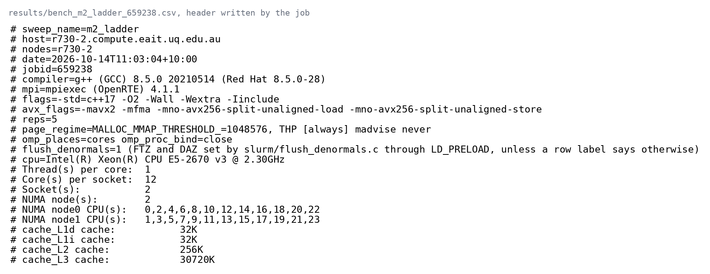{width="1400px" fig-align="center"}
